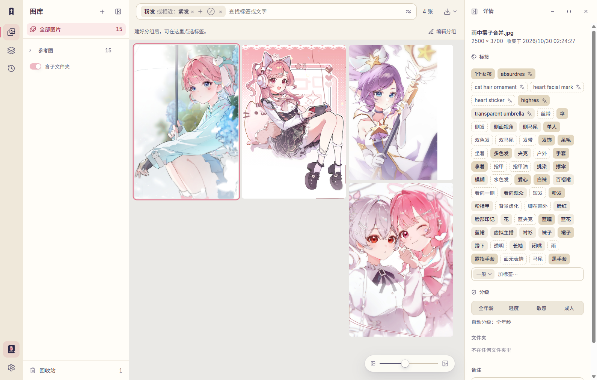
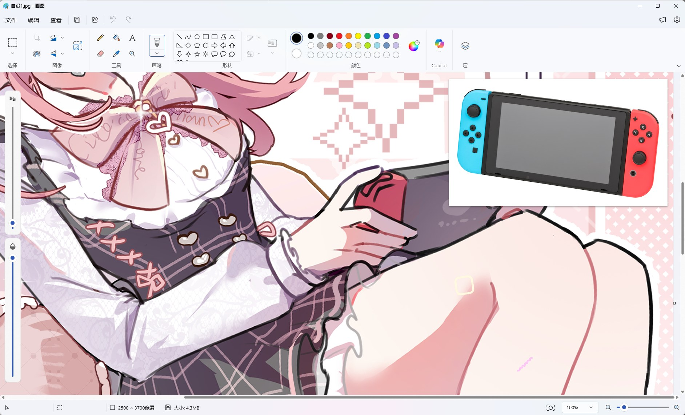

  <picture>
    <source media="(prefers-color-scheme: dark)" srcset="design/logo-kit/lockups/horizontal-night.svg">
    
  </picture>

  Your forbidden library: hoard every reference, find any of them.

  
  
  

  <b>English</b> · <a href="docs/readme/README.zh-CN.md">简体中文</a>

---

Kinshoko is a reference library for illustrators: images are tagged as you save them, a search finds what you want to draw, and what you find pins next to your canvas.

> [!NOTE]
> Kinshoko runs on Windows 10/11 x64. The interface is in Simplified Chinese for now.

## Tagged for you, found in seconds

Hair color, outfit, pose and more are tagged automatically. Search for pink hair, umbrella and squatting, and the matches come up out of thousands of images; pink hair also brings in close matches such as purple hair. Fix any tag whenever you like.

## Pinned next to your canvas

Pin a whole image, part of one, or anything on screen above your painting app. Flip, rotate, fade it, or tuck it against the screen edge.

Pins are the original: select part of an image in Kinshoko and you get it at full resolution, sharp when you zoom in, with colors the eyedropper reads exactly.

Switch photo in the pin: Evan-Amos, public domain, via <a href="https://commons.wikimedia.org/wiki/File:Nintendo-Switch-wJoyCons-BlRd-Standing-FL.jpg">Wikimedia Commons</a>.

## Also

- **Save in a moment**: drag in, paste, take a screenshot, or import a folder.
- **Reference groups**: keep one piece's references together and bring them back anytime.
- **Safe mode**: on by default, so adult images don't pop up on your screen.
- **All local**: no account, works offline, never changes your originals.
- **Move over from Eagle**: tags and folders come along.

Planned directions, such as image similarity search, semantic search, color search and multi-device sync, are listed in the [roadmap](docs/discovery/roadmap.md) (in Chinese).

## Install

1. Download `Kinshoko_<version>_x64-setup.exe` from [Releases](https://github.com/Yukk1No/kinshoko/releases).
2. Run it. The installer installs for the current user only and does not need administrator rights. It installs the Microsoft Edge WebView2 runtime if missing (Windows 11 already includes it).
3. Windows SmartScreen may say "Windows protected your PC" because the installer is not code-signed yet. If you downloaded it from this repository's Releases page, choose **More info → Run anyway**.

Kinshoko checks for updates from GitHub Releases and verifies each update's signature before installing it. Uninstalling never deletes your libraries.

The tagging model is not bundled. Kinshoko downloads it from Hugging Face the first time automatic tagging runs, and shows the download size first.

## Privacy

Kinshoko works offline on your own machine. There is no telemetry and no account. Kinshoko connects to the network only to:

- check for and download updates from GitHub Releases;
- download the tagging model from Hugging Face, once;
- let the installer download the Microsoft Edge WebView2 runtime from Microsoft, only if it is missing.

The diagnostics in **设置 → 诊断** (Settings → Diagnostics) list only system, GPU, WebView2 and display information, never file names, paths or images, so you can paste them into an issue. **存成文件…** (Save as file) bundles them with the last 7 days of the run log (运行日志) into a zip. The run log records errors, warnings and the timing of captures, pins, tagging and windows, never file names, paths, tag text or images. It stays on your machine, keeps at most 7 days or 20 MB, and is on by default only in test builds.

## Feedback

Feedback from illustrators is the most useful contribution right now. [Open an issue](https://github.com/Yukk1No/kinshoko/issues/new/choose) using one of the templates:

- **UX feedback**: anything awkward, hard to find, or that interrupts your drawing.
- **Tag error**: an automatic tag or content rating that is clearly wrong.
- **Compatibility result**: how pinning behaves with your tablet, display and painting app.

Writing in Chinese or English is fine. To report a security issue, see [SECURITY.md](.github/SECURITY.md).

## Contributing

See [CONTRIBUTING.md](CONTRIBUTING.md) for the development setup, project layout and how to propose changes. Domain terms are defined in [GLOSSARY.md](GLOSSARY.md), and the major decisions are recorded in [docs/adr/](docs/adr/).

## License

Kinshoko is free software, licensed under the [GNU General Public License v3.0 or later](LICENSE).

As an additional permission under GPLv3 section 7, Kinshoko may be linked and distributed with ONNX Runtime and Microsoft DirectML, which the tagging subprocess ships alongside the app. See [LICENSE-EXCEPTION](LICENSE-EXCEPTION).

Bundled third-party material keeps its own license:

- The Inter and Source Han Sans SC fonts in [`public/fonts/`](public/fonts/) are under the SIL Open Font License 1.1.
- The Fluid Functionalism code in [`src/ui/vendor/fluid/`](src/ui/vendor/fluid/) is under the MIT License; see its [`LICENSE`](src/ui/vendor/fluid/LICENSE).
- The agent skills in [`.claude/skills/`](.claude/skills/) are under the MIT License; see [`LICENSE-mattpocock-skills`](.claude/skills/LICENSE-mattpocock-skills).
- The tagging models are not distributed with Kinshoko. They are downloaded at runtime and remain under the licenses stated on their model cards.
