# 主界面质感原型（#606）

一次性原型，回答一个问题：**查找框、左栏的行、面板之间，各用什么材质。** 第一轮给出三套方案（A、B、C），维护者选了 C；之后三轮都在 C 上改：第二轮把占掉的图片墙面积找回来（C2、C3），第三轮把底色改回米黄、详情栏默认收起（C4、C5），第四轮重做标签分组（C4a、C4b），维护者选了 C4a，第五轮按维护者的想法把分组入口换成查找框里的图标（C4c），第六轮改查找框选中的样子、给文件夹视图加质感与动作（C4d），第七轮只改选中并打开的那个文件夹（C4e），第八轮推敲子文件夹的层级（C4f、C4g，都不满意），第九轮在 C4e 上只换画法（C4h），第十轮在 PR #635 之后重做左栏的行（甲～戊，维护者选甲）。**现在的方向是 C4 加 C4c，C4e 往好的方向走了；子文件夹的层级用 C4h 的“折痕”，待确认。** 方案定下来之后，规则另开文档 PR 写进 `design/ui-system/`。这里的代码不进正式程序。

## 怎么看

仓库根目录运行（需要先 `npm ci`）：

```bash
npx vite --config design/prototype/main-window-material/vite.config.ts
```

打开 <http://127.0.0.1:1431/design/prototype/main-window-material/?variant=a>。底部的墨色切换条换方案（键盘 ← →）、换日夜、开关材质样本。

| 参数 | 值 |
| --- | --- |
| `variant` | `now` 现状、`a`、`b`、`c`，第二轮的 `c2`、`c3`，第三轮的 `c4`、`c5`，第四轮的 `c4a`、`c4b`，第五轮的 `c4c`，第六轮的 `c4d`，第七轮的 `c4e`，第八轮的 `c4f`、`c4g`，第九轮的 `c4h`，第十轮的 `ra`～`re`（左栏的行） |
| `inspector=1` | 打开详情栏；不写时收起，与正式程序的默认相同 |
| `theme` | `light`、`dark`；不写跟随系统 |
| `specimen=1` | 显示材质样本：输入框、下拉与已定材质的按钮、滑条、分段排在一起 |
| `bar=0` | 藏起切换条（截图用） |

页面上运行的是正式程序的 `<App />`：组件与样式表从 `src/` 原样引用，所以尺寸与正式程序一致，侧栏、查找框、菜单都能操作。后端换成 [backend.ts](backend.ts) 的样本数据，图片是开发服务器生成的色块。三套方案只是叠在最后的一张样式表 [variants.css](variants.css)，`src/` 没有改动。第四轮起有几个原型自己写的部件（[Groups.tsx](Groups.tsx) 的分组面板、[Folders.ts](Folders.ts) 的文件夹动作、[Tree.ts](Tree.ts) 的折起与两层图标），它们叠在正式程序的界面上。启动加载页在原型里藏起来了。

## 三套方案的四个回答

| | A 槽 | B 刻 | C 叠 |
| --- | --- | --- | --- |
| 一句话 | 面板不动，材质只加在控件上 | 界面是一整块板，分界是刻线，状态往下压 | 面板是三张纸，之间露出桌面，状态往上浮 |
| **1 输入类控件** | 槽：槽口上沿一线暗边、落进来的内阴影、一圈半像素线、下沿外侧一道亮边。日间槽底仍是 `--surface`，夜间改用更暗的 `--sunken` | 同一种槽，内阴影深一档（3 px 对 2 px） | 与 A 相同的槽，压在纸上 |
| **2 行的悬停与选中** | 悬停不变（平的 `--hover`）。选中是平的强调色浅底，加一圈半像素线。**与 dock 的选中块是同一种东西**，图标轨的当前项也是 | 悬停是浅凹（`--hover` 底加内阴影）。选中是强调色的浅槽，与精确查找开启时同一族。**与 dock 的选中块不是一种东西**：dock 是浮着的玻璃，上面的色块是平的；板上的行是压下去的 | 悬停不变。选中是一张凸起的小纸片：按钮的面与投影（`--btn-face`、`--btn-lift`），字仍是强调色。**与 dock 的选中块不是一种东西**，与按钮是一种东西 |
| **3 面板的前后** | 底色两档加 1 px 线，与现在相同。不用投影 | 底色：左栏、顶栏、分组条、详情栏同一个底色，图标轨深一档，图片墙是板上开的窗。线：刻线，一道暗线旁边一道亮线。不用投影 | 底色：桌面（`--rail`）与纸两档。投影：三张纸各有半像素线、近处一层小投影、上沿亮边，落在 8 px 的桌面上。线：只留纸内部的 1 px 线 |
| 分组条 | 不变：与顶栏同底，下沿一条线 | 与顶栏并成一条，和两侧栏同底，下沿是板的边 | 与顶栏在同一张纸上，图片墙在纸的下半 |
| **4 令牌** | `--well-floor`、`--well-inset`、`--well-inset-hover`、`--sel-edge` | A 的三个 `--well-*`，加 `--chrome`、`--groove-dark`、`--groove-light`、`--pressed-hover`、`--pressed-on` | A 的三个 `--well-*`，加 `--desk`、`--sheet-gap`、`--sheet-main`、`--sheet-lift`、`--sheet-top` |

### 各方案改了什么、代价是什么

- **A**：只动查找框、`.k-input`、`.k-select` 和选中块的一圈线。面板“没有前后关系”这一条没有解决，只是定下来：贴边的面板靠底色与线，前后关系留给浮着的东西。改动最小，#607、#608 几乎不受影响。
- **B**：日间顶栏与分组条从米黄（`--bg`）换成纸白（`--surface`），夜间左栏与详情栏从 `--surface` 换成更暗的 `--bg`，所以两个主题下都是一整块。日间板是纸白，亮线看不见，刻线只剩一道暗线；夜间才是完整的一暗一亮。悬停块有了内阴影，滑动时比现在重一点。
- **C**：三张纸之间和窗口四周各留 8 px，详情栏打开时图片墙因此变窄 24 px、变矮 16 px。面板有了 12 px 圆角，图片墙的下面两个角跟着纸的圆角裁掉。夜间主区的纸（`--bg`）比两侧的纸（`--surface`）暗一档，三张纸不是同一个底色，原因见下面“对比度”。窗口最大化时四周也留着 8 px 桌面。

## 第二轮：C 的整体迭代

维护者的意见（2026-11-14）：C 最好看；面板浮起来之后可以用投影；占图片墙面积的问题靠迭代整体设计解决。C 的材质（槽、凸起的选中行、纸的投影与亮边）不变，变的是谁做桌面。

| | C 叠 | C2 墙做桌面 | C3 墙做桌面，顶栏一行 |
| --- | --- | --- | --- |
| 桌面 | 图标轨的米黄（`--rail`） | 图片墙的中性灰（`--wall`） | 同 C2 |
| 图片墙 | 在主区那张纸里，四周被间隙扣掉 | 就是桌面，从窗口顶铺到窗口底；三张纸浮在它上面 | 同 C2 |
| 纸 | 左栏、主区（顶栏加分组条加图片墙）、详情栏 | 左栏、顶栏加分组条、详情栏 | 同 C2；主区宽 1100 px 起，分组条并进顶栏那一行 |
| 图片墙比现在（1280 × 800，详情栏开着） | 窄 24 px、矮 16 px | 一样宽，矮 8 px | 窄窗口同 C2 |
| 图片墙比现在（1920 × 1080，详情栏开着） | 窄 24 px、矮 16 px | 一样宽，矮 8 px | 一样宽，高 33 px |
| 投影落在哪 | 桌面上 | 图片墙上：两侧落在墙边 12 px 的留白里，碰不到图；顶栏那张纸的投影落在滑到它下沿的图上 | 同 C2 |

C2 怎么把面积找回来的：

- 纸与纸之间的 8 px 间隙就是图片墙本身，不再是从图片墙里扣出来的米黄桌面。
- 详情栏右边的 8 px 桌面算在它自己的宽度里（320 = 纸 312 + 桌面 8），图片墙的宽度与现在相同。
- 图片墙的上沿藏在顶栏那张纸下面 12 px，图片从纸的圆角后面滑出来。

C2、C3 要知道的：

- **界面的底从米黄变成中性灰。** 米黄只留在纸上（`--surface`）。日间 `--rail` 与 `--wall` 明度接近，整体只是少了一点暖色；夜间两者本来就几乎一样。图标轨的图标直接放在灰底上。
- **顶栏的投影会落在图上。** 这是唯一画到图片上的东西：图滑到顶栏下沿时，最上面约 10 px 会被一层很淡的投影压暗。不接受的话，顶栏那张纸改用半像素线、不用投影。
- **夜间顶栏那张纸（`--bg`）比两侧的纸（`--surface`）暗一档**，原因同 C：顶栏的字现在就在 `--bg` 上，换亮会降低对比度。
- **C3 只是摆给人看的。** 原型用 CSS 锚点定位把分组条摆进顶栏那一行，没有改组件；分组多到一行放不下时怎么收，没有做；查找框的最大宽度从 960 px 收到了 480 px。这些是 #607（顶栏的呈现）的事。
- 第一轮的对比度表对 C2、C3 同样成立：文字的底色与 C 相同。

| | 日间 1280 × 800，详情栏打开 | 夜间 1280 × 800，详情栏打开 |
| --- | --- | --- |
| C | 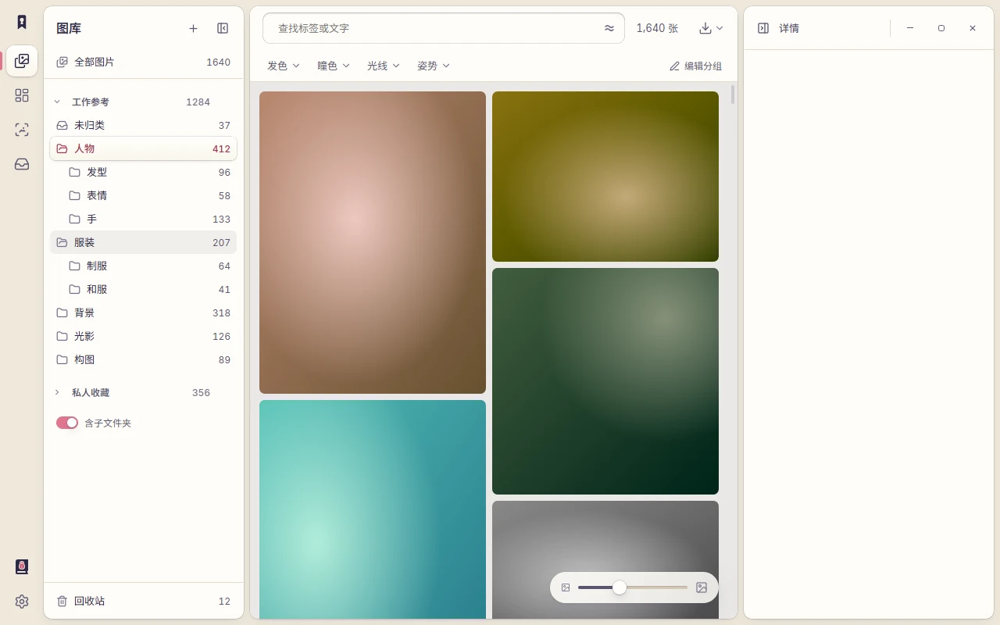 | 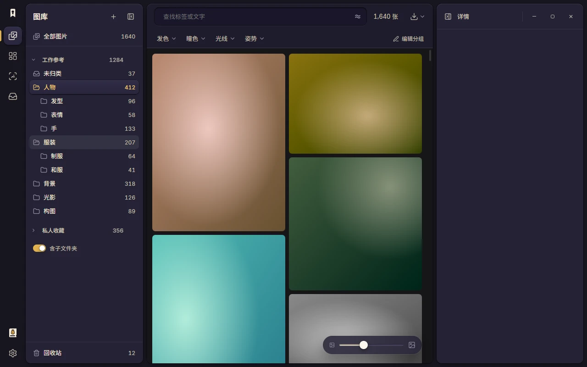 |
| C2 | 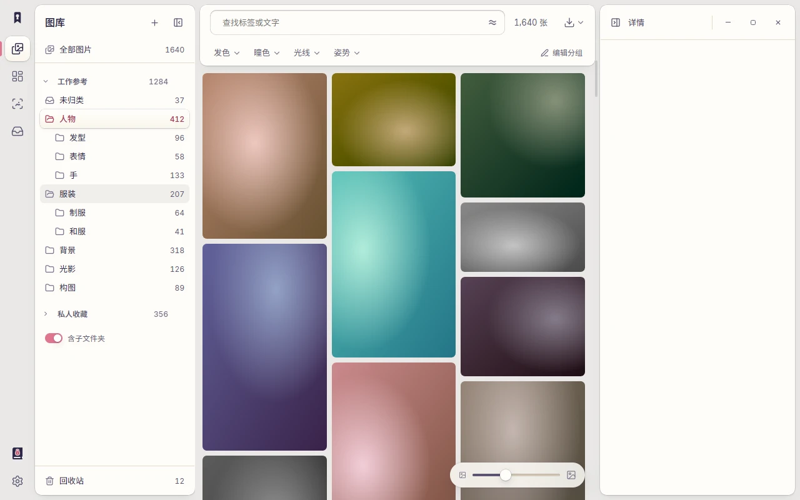 | 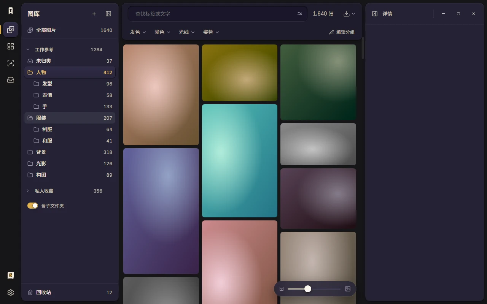 |

| | 日间 1920 × 1080 | 夜间 1920 × 1080 |
| --- | --- | --- |
| C2 | 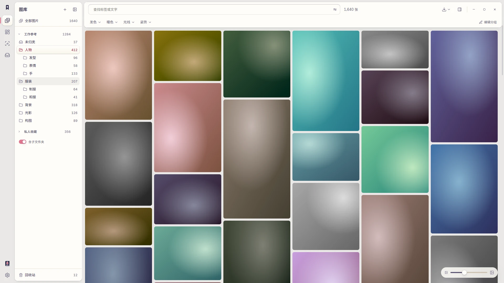 | 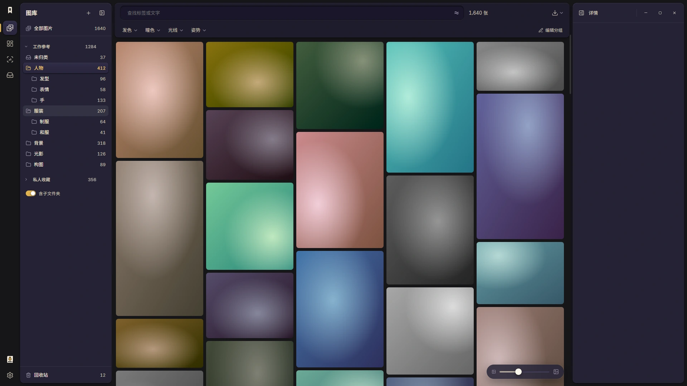 |
| C3 |  | 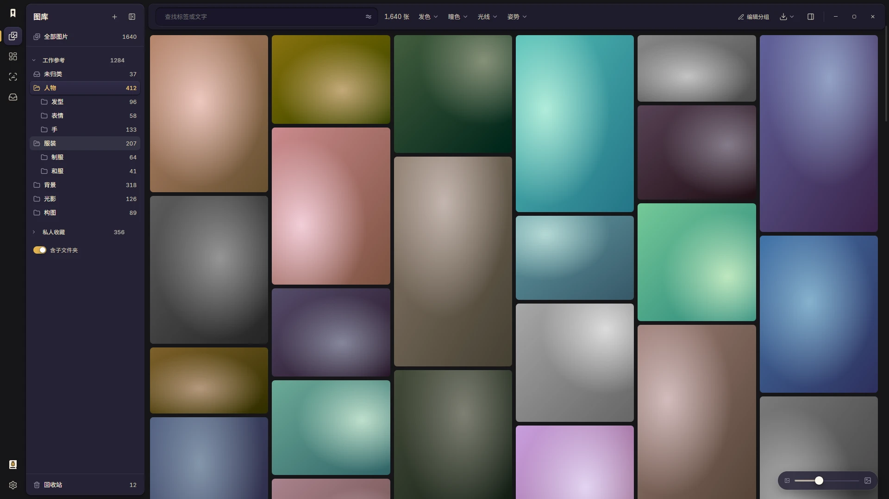 |

C2、C3 比 C 多改的令牌只有一个：`--desk` 从 `--rail` 换成 `--wall`。

## 第三轮：米黄桌面，详情栏默认收起

维护者的意见（2026-11-14）：C2 不错，但灰底与米黄衔接得奇怪，画师也反馈过更喜欢温暖的米黄；详情栏现在不重要，不必默认弹出。

- **详情栏**：正式程序里它本来就默认收起、只由画师亲手打开（工具栏按钮或 I 键），打开与否记在本机设置里。前两轮的截图里它开着，是原型的样本数据按 #606“空的详情栏”设的。这一轮起原型默认收起，所有整屏截图都是收起的样子，另出一张打开的（`*-1280x800-inspector-*`）。收起之后，平时的界面是两张纸：左栏与主区。
- **底色**：图片墙必须是中性灰（不给参考图染色），桌面要米黄，所以图片墙不能再做桌面，它得有自己的边界。C4 让它回到主区那张纸里，和 C 一样。

| | C 叠 | C4 米黄桌面 | C5 纸铺到边 |
| --- | --- | --- | --- |
| 桌面 | 米黄（`--rail`） | 同 C | 同 C |
| 主区那张纸 | 四周各留 8 px | 同 C | 铺到窗口的右边与下边，只留左上的圆角；详情栏打开时右上也是圆角 |
| 左栏 | 256 的纸，右边另留 8 px | 256 = 纸 248 + 桌面 8 | 同 C4 |
| 详情栏（打开时） | 320 的纸，左右各另留 8 px | 320 = 桌面 8 + 纸 312，右边另留 8 px | 同 C4 |
| 顶栏 | 两行 | 主区宽 1100 px 起并成一行（同 C3） | 同 C4 |
| 图片墙比现在（1280 × 800） | 窄 16 px、矮 16 px | 窄 8 px、矮 16 px | 一样宽，矮 8 px |
| 图片墙比现在（1920 × 1080） | 窄 16 px、矮 16 px | 窄 8 px、高 25 px | 一样宽，高 33 px |

上表按详情栏收起算。投影都落在桌面上，图片墙上不画东西，第一轮“贴着图片墙的面板不能用投影”那一条在 C4、C5 里仍然成立。

要知道的：

- **前两轮说的“三列变两列”不是结构问题。** 列数是图片墙宽度除以画师选的图片大小再取整，哪种宽度下都会有一个临界点；那张截图恰好踩在上面。真正的代价只是上表里的像素数。
- **左栏的纸窄了 8 px**（248），里面的行跟着窄 8 px，样本数据里没有文字被截断。
- **C5 的纸不再是“浮着的一张”**：它的右边和下边贴着窗口，看起来更像桌面右下铺开的一大张。换来的是图片墙与现在一样宽。
- 顶栏并成一行仍是用 CSS 锚点定位摆的，没有改组件（同 C3 的说明）。

| | 日间 1280 × 800 | 夜间 1280 × 800 |
| --- | --- | --- |
| C4 | 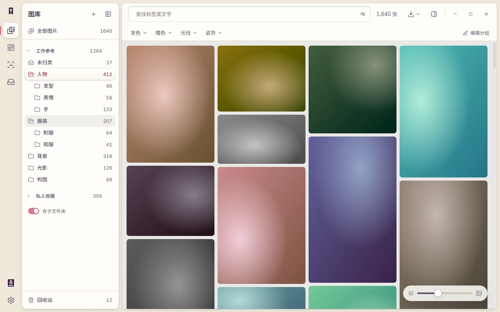 |  |
| C4，详情栏打开 | 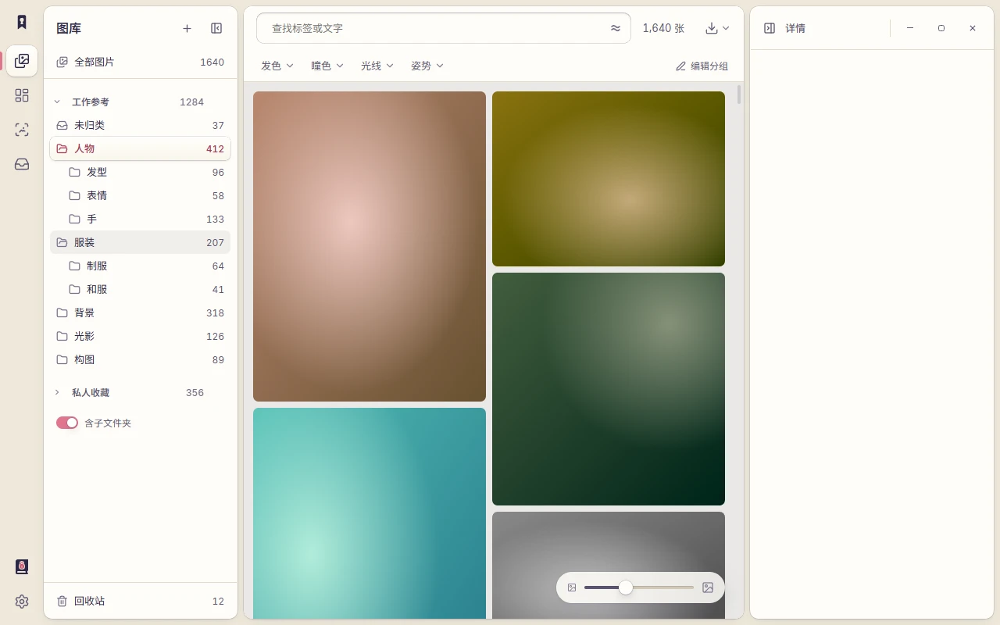 | 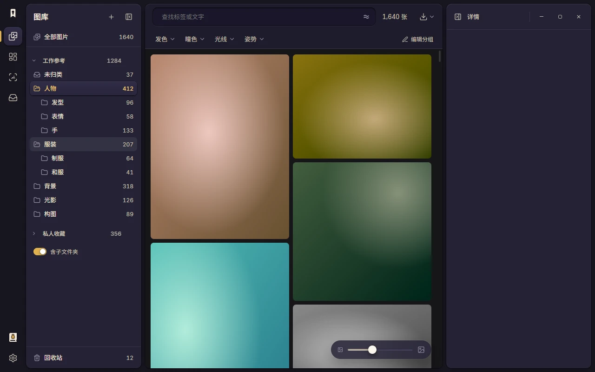 |
| C5 | 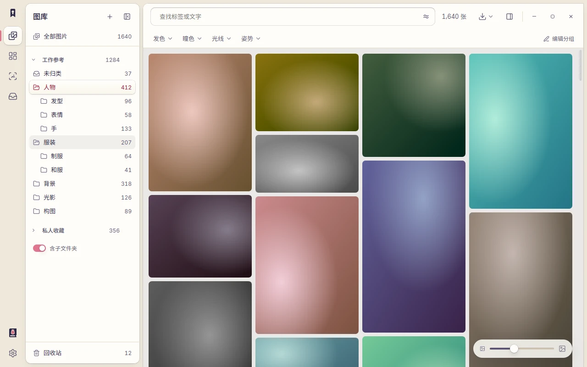 | 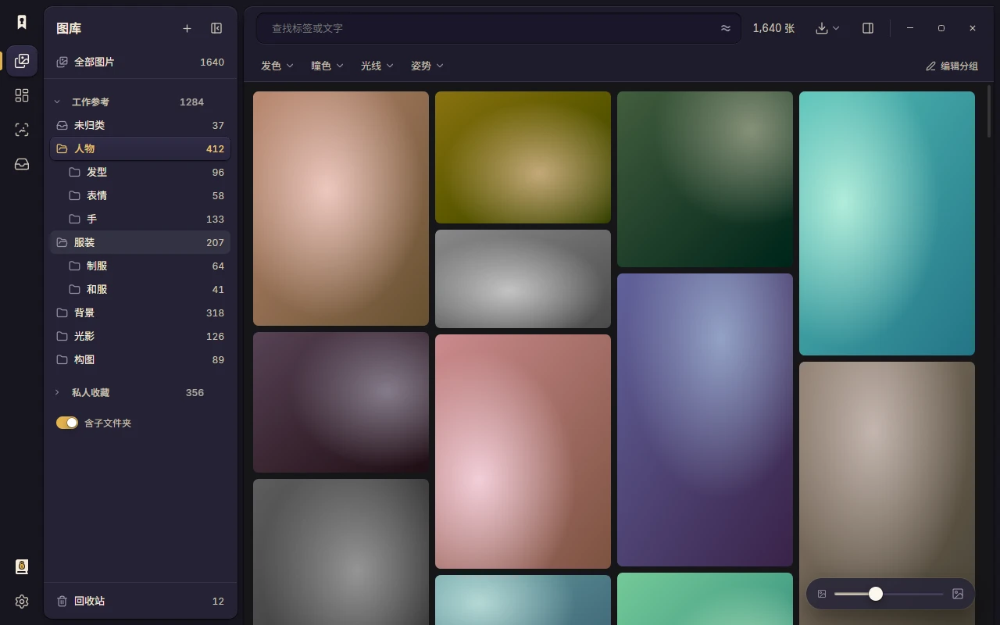 |

| | 日间 1920 × 1080 | 夜间 1920 × 1080 |
| --- | --- | --- |
| C4 |  |  |
| C5 | 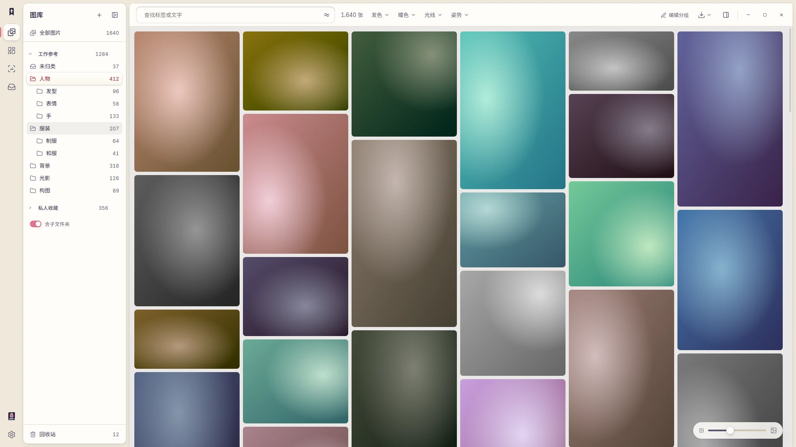 | 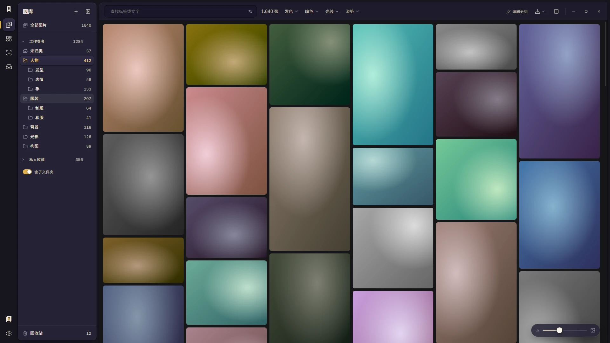 |

| | 日间 200% | 夜间 200% |
| --- | --- | --- |
| C4 | 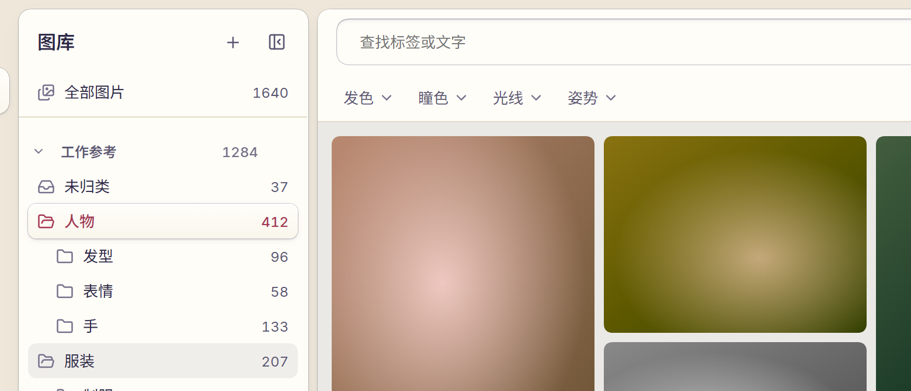 | 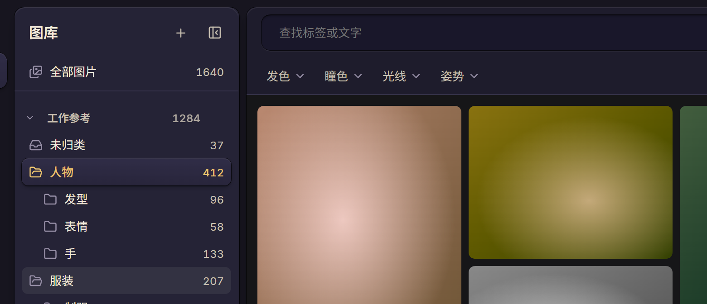 |

## 第四轮：标签分组与“编辑分组”

维护者的意见（2026-11-14）：C4 不错；标签分组和“编辑分组”要彻底调整。

现在的分组条是顶栏下面单独的一行：几个分组名靠左，“编辑分组”靠最右，中间是空的；每个分组各开一个浮层，跨两个分组选标签要开两次。两种新摆法都取消这一行，顶栏在任何宽度下都只有一行，都接在正式程序的查找条件上（选了标签，查找框里出现真的条件，可以在那里去掉或排除）。

| | C4（第三轮） | C4a 分组进查找 | C4b 分组进左栏 |
| --- | --- | --- | --- |
| 分组在哪 | 顶栏下面一行；主区宽 1100 px 起并进顶栏 | 查找框后面一个“分组”按钮，点开一块面板 | 左栏滚动区里的一段，在图库下面 |
| 怎么选 | 点分组名开浮层，再点标签；每个分组一个浮层 | 面板里所有分组的标签一次摆出来，可以跨分组连选，面板不关 | 展开分组，点标签那一行；选中的行是凸起的小纸片 |
| 选了几个 | 分组名后面的数字 | “分组”按钮上的数字，面板里的标签变色 | 分组那一行的数字，标签行凸起 |
| 任一成员 | 浮层顶上的按钮 | 指针移到分组上时，分组名右边出现 | 没有做 |
| 编辑分组 | 分组条最右的文字按钮 | 面板底部的一行 | “标签分组”标题行悬停时出现的笔形按钮 |
| 图片墙比现在（1280 × 800） | 窄 8 px、矮 16 px | 窄 8 px、高 25 px | 同 C4a |
| 图片墙比现在（1920 × 1080） | 窄 8 px、高 25 px | 窄 8 px、高 25 px | 同 C4a |

要知道的：

- **C4a 的代价是分组名不再常驻。** 平时只看得到“分组”两个字，分组名要点开才有。点击次数没有变多：现在是点分组、点标签两下，C4a 是点“分组”、点标签两下；跨分组选第二个标签时现在要再开一个浮层，C4a 只多一下。
- **C4b 的代价是左栏变长。** 图库展开、文件夹多的时候，分组会被挤到滚动区下面（1280 × 800 的截图里只露出第一个分组，第二个要滚动才看得到）。左栏原本只管“看哪里”（浏览范围），分组是“筛什么”，两样东西放进了同一栏。#98 当时把分组的编辑从左栏移了出去，C4b 等于把分组的使用放回左栏。
- **两种摆法里“编辑分组”都退到第二层。** 它不是每次查找都要用的东西，不再占顶栏的位置。点它打开的仍是正式程序的“编辑分组”对话框。
- 顺带做了 #607 的两项，这两个版本里才有：查找框开头加了查找图标，最大宽度从 960 px 收到 560 px。张数与导入的位置没有动。
- 原型里的分组面板与左栏分组是原型自己写的组件（[Groups.tsx](Groups.tsx)），从正式程序分组条的 React 节点上读查找条件，正式实现时要重写。分组多到面板放不下时面板内部滚动；左栏里分组多时跟着左栏滚动。

| | 日间 1280 × 800 | 夜间 1280 × 800 |
| --- | --- | --- |
| C4a，面板打开，选了“蓝发”“红瞳” | 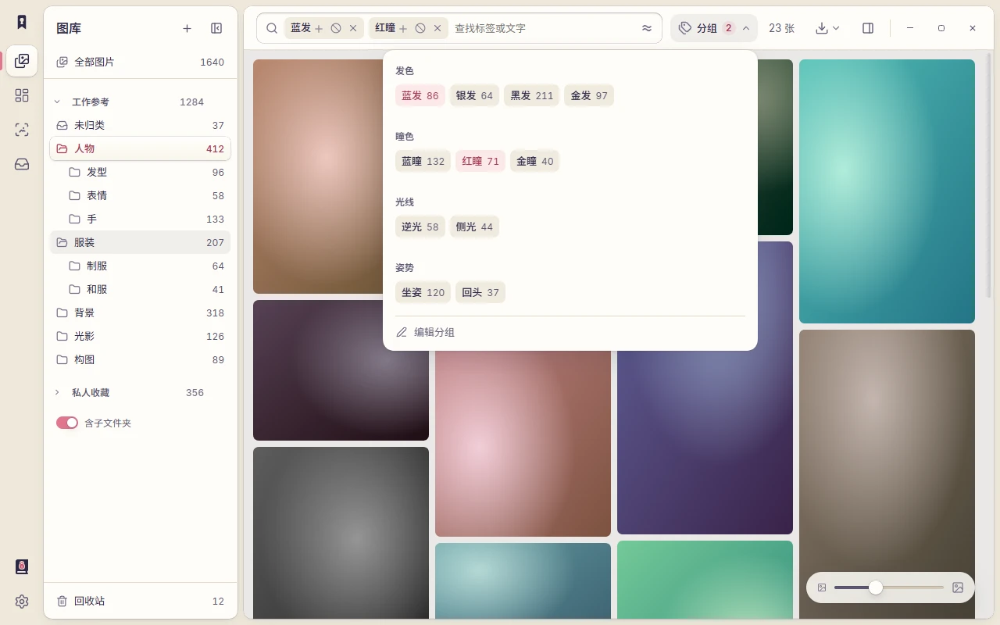 | 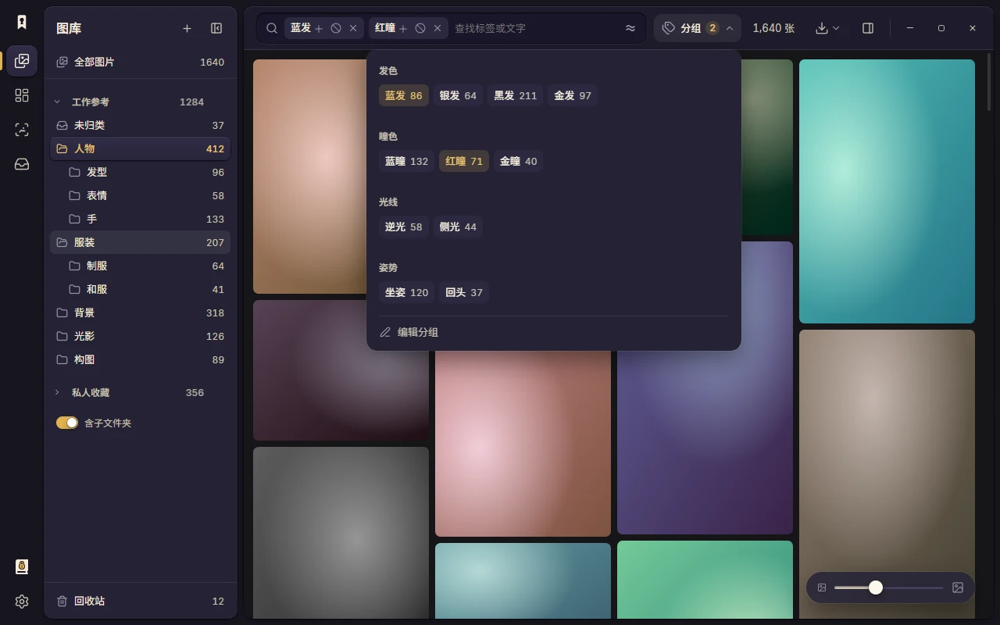 |
| C4b，展开“发色”“瞳色” | 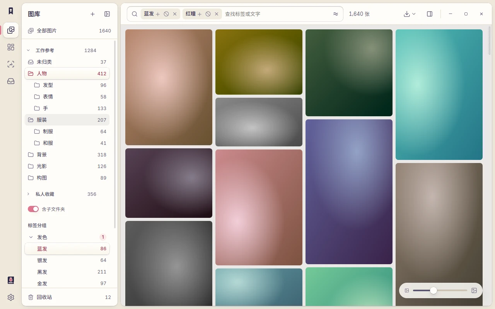 | 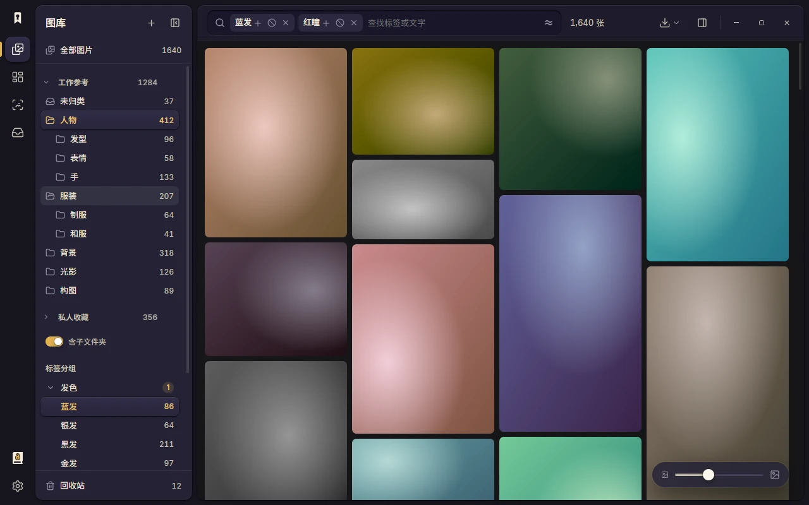 |

| | 日间 1920 × 1080 | 夜间 1920 × 1080 |
| --- | --- | --- |
| C4a | 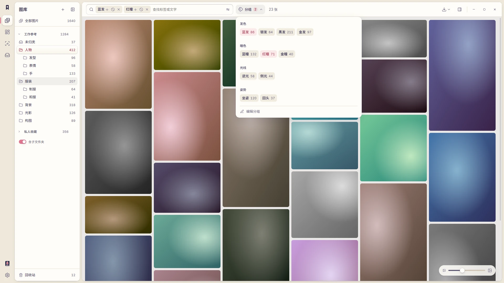 | 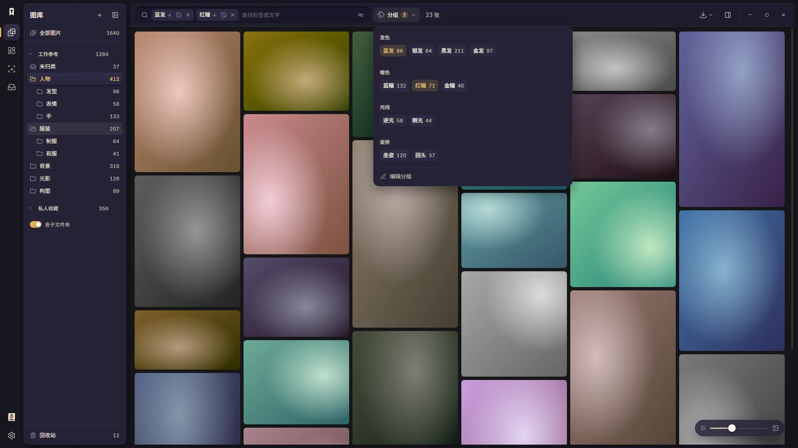 |
| C4b |  | 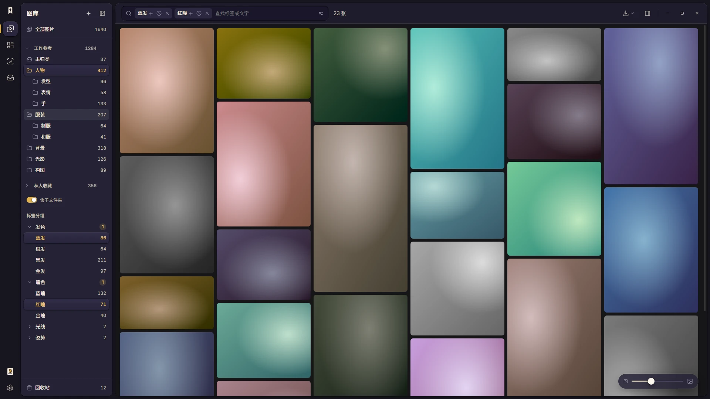 |

## 第五轮：分组图标进查找框，张数不常驻

维护者的意见（2026-11-14）：C4a 挺好；考虑删掉“xx 张”，“分组”两个字换成图标、放进查找框。

C4c 在 C4a 上改了三处：

- **分组入口**：查找框里的一个图标按钮（标签图标，32 × 32，与精确查找开关同样大小），排在开关前面；名称“标签分组”在悬停提示和无障碍名称里。
- **分组面板**：挂在查找框正下方、与查找框同宽（不窄于 420 px），不再从按钮下面斜着出来。查找框与面板看起来是一件东西。
- **张数**：没有删，改成只在有查找条件时出现，位置在查找框里、分组图标的前面。没有条件时它等于左栏选中那一行的数字，重复了；有条件时它是“筛完还剩几张”的唯一反馈，所以留着。

顶栏因此只剩：查找框，导入，详情栏开关，窗口控件。查找框的最大宽度放到 640 px（里面多了张数与一个图标）。

| | 日间 1280 × 800 | 夜间 1280 × 800 |
| --- | --- | --- |
| C4c，面板打开，选了“蓝发”“红瞳” | 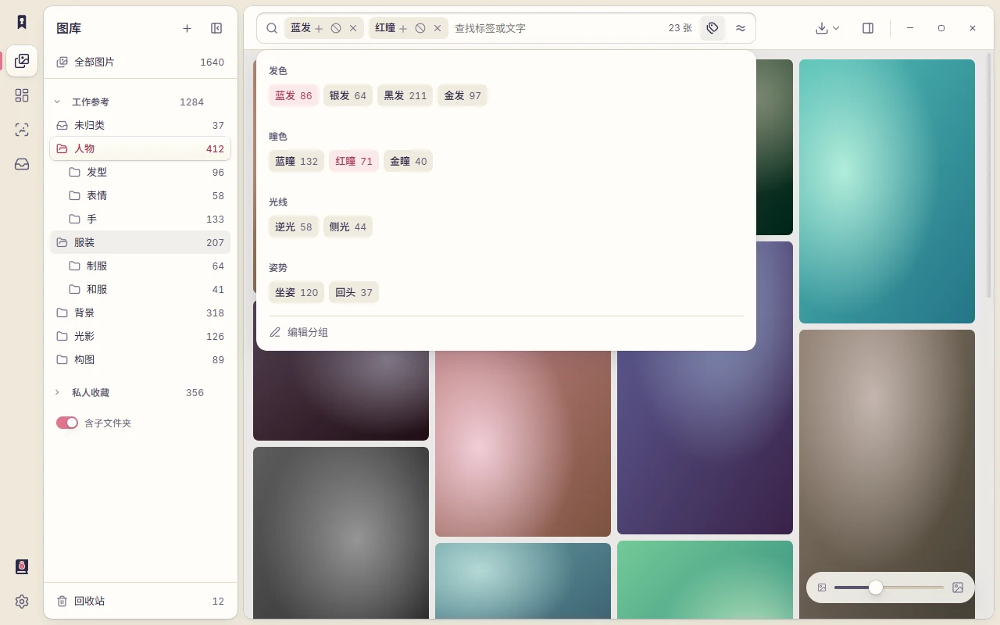 | 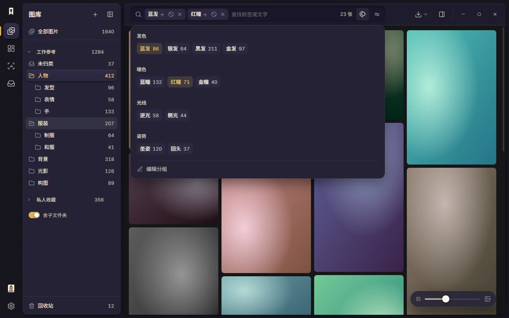 |
| C4c，没有查找条件，详情栏打开 | 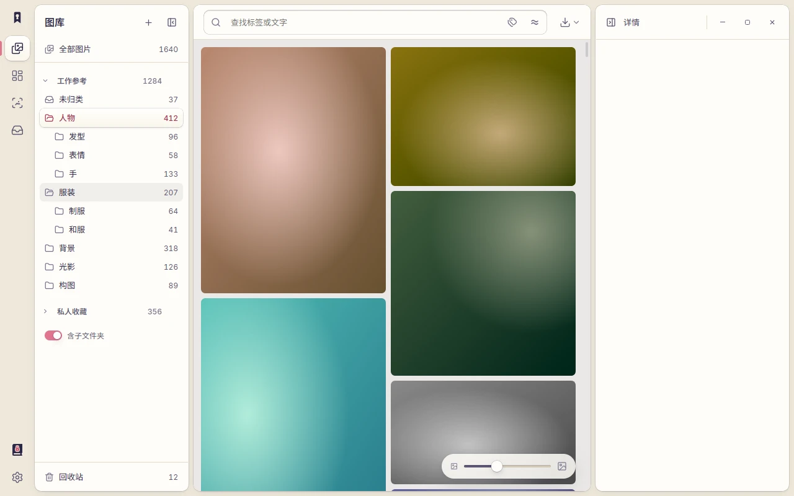 | 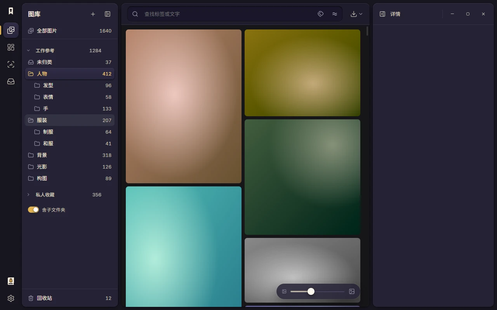 |
| C4a，没有查找条件，详情栏打开 | 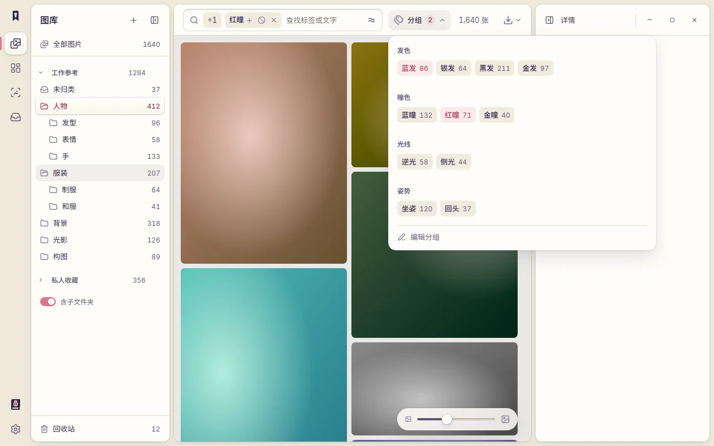 | 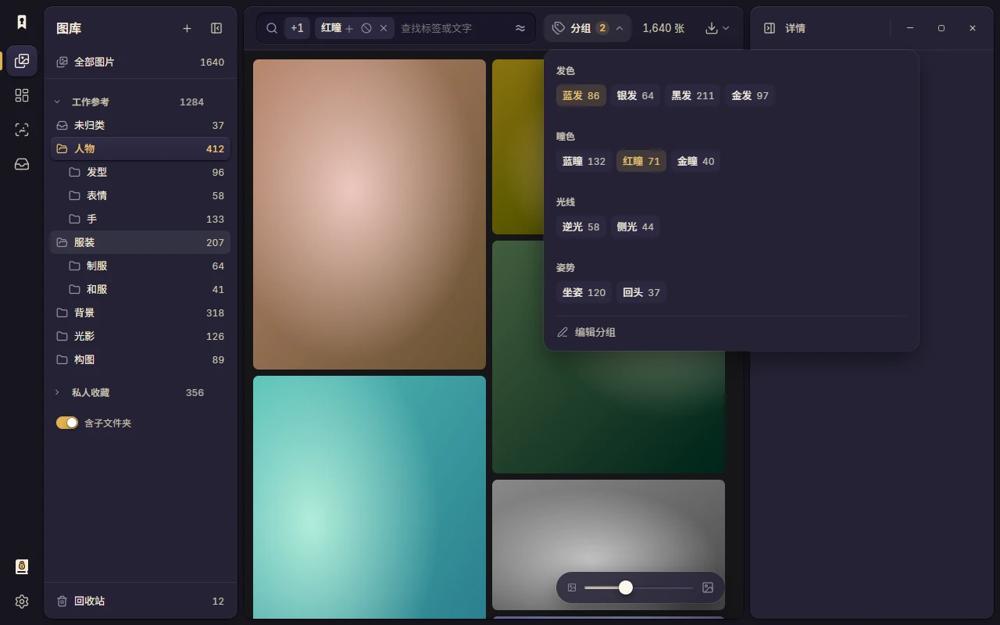 |

| | 日间 1920 × 1080 | 夜间 1920 × 1080 |
| --- | --- | --- |
| C4c | 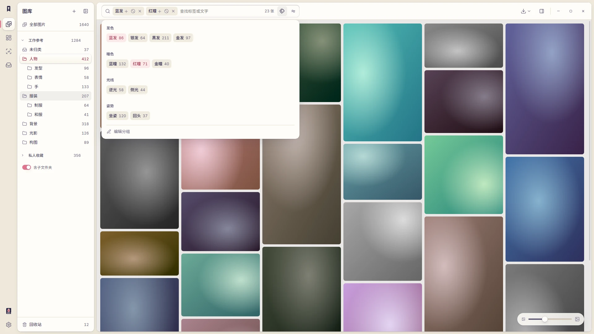 | 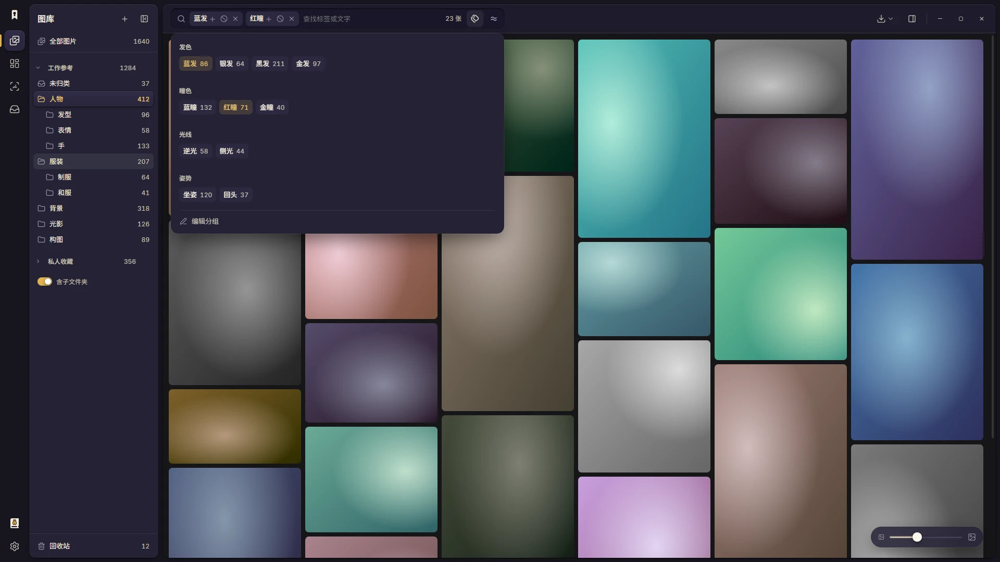 |

要知道的：

- **查找框尾部有两个没有文字的图标**：分组（点开面板）与精确查找（开关）。两者的区别靠图形与悬停提示；第一次用的人要悬停一下才知道哪个是哪个。
- **选了几个分组标签不再有数字提示**（C4a 的“分组”按钮上有）。选中的标签本身就在查找框里，条件多到收进“+n”时才看不全。
- 原型里的张数在选一个标签时是 86、两个是 23，是样本数据按条件个数给的假数。
- 张数、分组入口放进查找框之后，条件块的收纳（`fitChips.ts` 按可用宽度算显示几个）在正式实现里要把这两样的宽度算进去；原型没有管。

## 第六轮：查找框选中的样子，文件夹视图的质感与动作

维护者的意见（2026-11-14）：查找框选中时的粉色高亮粗糙、颜色也不合，考虑还要不要；文件夹视图仍然扁平、没有质感；最要紧的是没有动作，并给了一段“拖动排序该是什么手感”的描述。

C4d 在 C4c 上改三处。动作在浏览器里看得最清楚：打开 `?variant=c4d`，展开“工作参考”，拖一个文件夹。

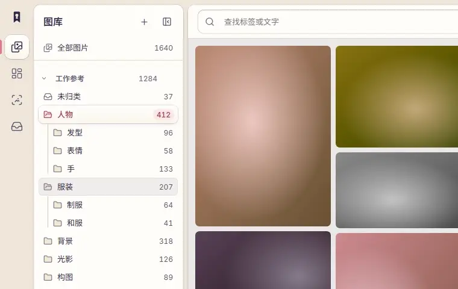

### 1. 查找框选中时不画粉色的环

| | 日间 200% | 夜间 200% |
| --- | --- | --- |
| C4c（现在的规则：2 px 强调色的环） | 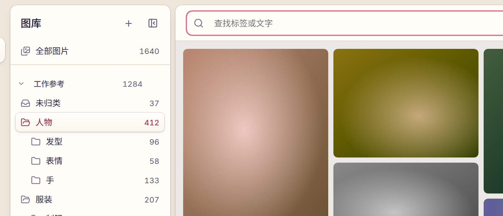 | 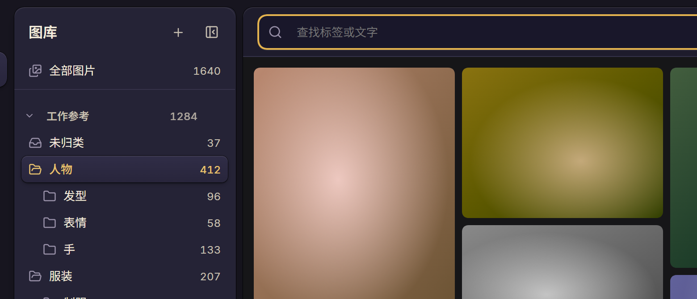 |
| C4d |  |  |

- 选中时槽口那一圈线变实：日间墨色 55%，夜间奶油色 50%，1 px；外面一圈 3 px 很淡的晕（8%）；放大镜从灰变成墨色。没有强调色。
- 这条规则给所有输入类控件（查找框、`.k-input`、备注框）。理由：输入框选中时里面有光标，本来就看得出在哪里；而它每次点进去都会画环，是界面上最常出现的一圈粉色。
- 按钮一类的控件不变：仍是 2 px 强调色的焦点环，只在用键盘走到时出现（#489 的规则）。所以 #489 那一条要加一个例外，不是废掉。
- 填错的输入框仍是红色的线，不受影响。

### 2. 文件夹视图

- **文件夹图标有了底色**：牛皮纸的金（`--manual-soft`，已有的色），日间下面有半像素的投影。选中的那一行是强调色的浅底。原来只有一圈灰线。
- **子文件夹左边一道引线**，从上一层图标的中线垂下来（`--line-2`），看得出谁在谁里面。
- **选中的小纸片会滑**：换一行时，纸片从旧的一行滑到新的一行（弹簧，约 0.36 秒）。隔着分界线的（“全部图片”、回收站）不穿过去，原地浮起来。
- **选中行的张数**放在一个强调色浅底的小圆角块里（与界面里已有的数字角标同一种）。
- **悬停的那一块**加了半像素的边，滑动时像一块东西在动，不是一片颜色。
- **按下一行**缩到 98.5%，松开弹回。
- **图库之间**一道分界线。
- **图库展开**时目录从上往下展开、各行依次落下（每行晚 18 ms）；**收起**时合上；箭头转过去。

### 3. 拖动文件夹

正式程序现在只能把文件夹拖到另一个文件夹上（放进去），用的是浏览器自带的拖放，手里是一张半透明的截图，别的行不动。C4d 里：

| | 日间 200% | 夜间 200% |
| --- | --- | --- |
| 拖到两行之间：线两边的行让开 | 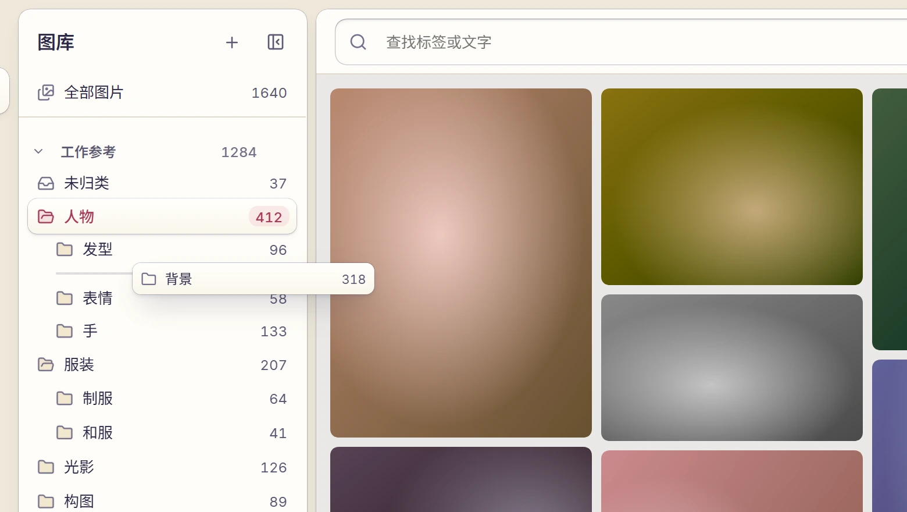 | 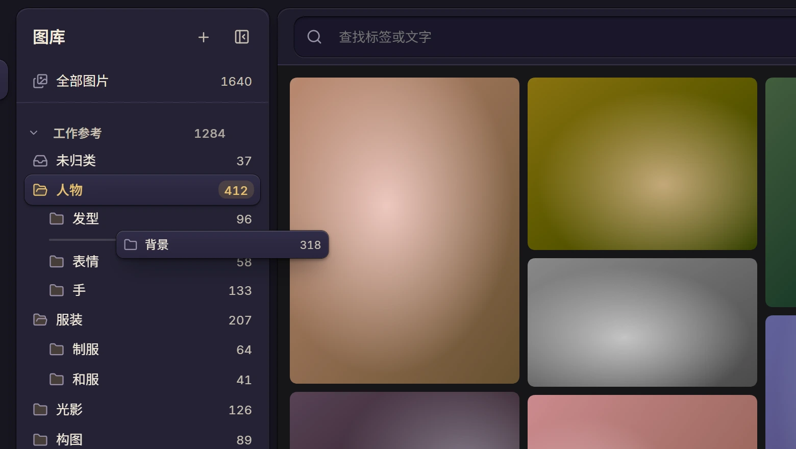 |
| 在一行上停住：放进这个文件夹 | 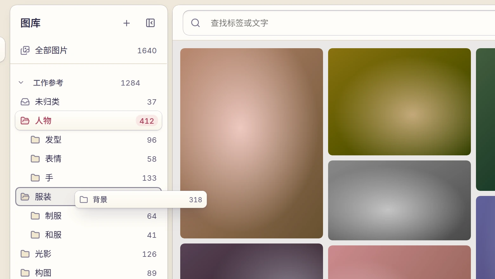 | 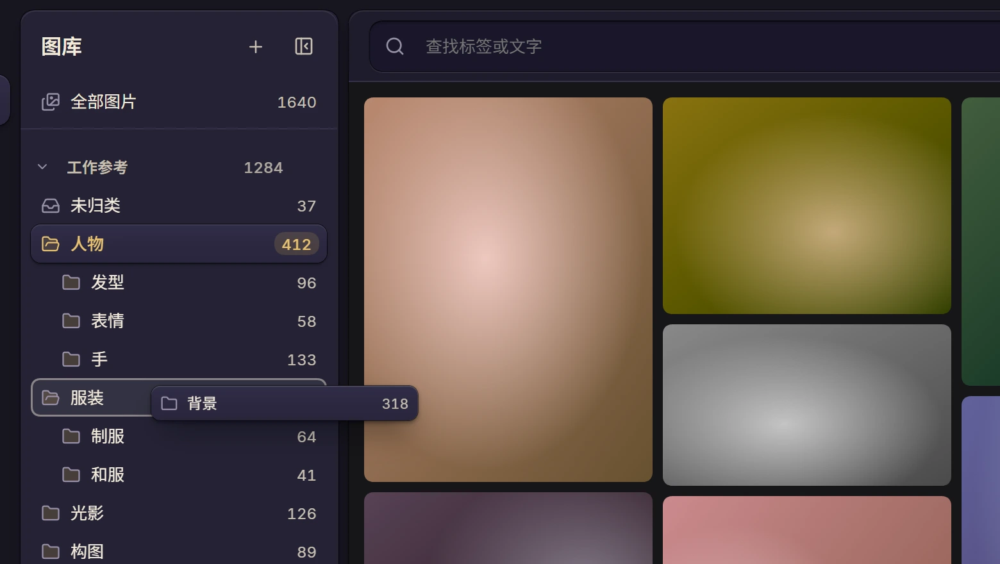 |

- **指针**：在文件夹上是手指，拖着的时候是抓住的手。
- **拿起来**：那一行跟着指针走，缩到 90%，挂在指针的右边，所以指针左边的落点一直看得见。里面有子文件夹时，下面垫着一张，看得出拿的是一摞。它原来的位置合上。
- **落点**：两行之间一道细线（2 px，文字色的 15%），从中间长出来，换位置时滑过去。它自己原来的位置上不画线。
- **让开**：线两边的行各自退开，离线最近的退 6 px，往外每一行是前一行的 0.7 倍，并且晚 24 ms 出发；弹簧约 0.28 秒，几乎不过冲。
- **放进文件夹**：在一行的中段停 0.32 秒，这一行出现一圈墨色的线，松手就放进去。
- **换层**：同一道缝可能属于两层（一组的末尾，或外面一层）。默认留在原来那一层，往左带一带就到外面一层，线的左端跟着缩进。
- **松手**：那一行落进缝里，其余各行弹到新位置（离落点越远越晚出发）。
- **取消**：按 Esc，或拖到左栏外面松手，各行弹回，手里的那张飞回原位。
- **键盘**：焦点在文件夹上时，Alt + ↑ ↓ 在同级里挪，Alt + → 放进上一个文件夹，Alt + ← 移到外面一层；结果会读给读屏用户。
- **减少动态效果**（系统设置）：只留落点的线，行不让开、不弹，纸片不滑。
- 每种动作各用一条曲线：跟手是带一点迟滞的趋近（约 40 ms），拿起来是一个小的回弹，让开与弹回是几乎不过冲的弹簧，落下的回弹稍多一点，线换位置是不回弹的缓出。位移都用 transform，不动排版。

数值与给的描述有一处不同：让开的距离用了 6 px（描述里卡片是 8 px）。左栏的行高只有 30 px、行与行之间没有空隙，8 px 会压到上一行的字。

### 要知道的

- **截图是静止的**，录像只有一段。手感要在浏览器里拖一下才知道。
- **落点的线很淡**（15%）。行让开之后缝有 12 px，线是次要的提示；觉得找不到落点的话先加深线。
- **拖动只在原型里**。正式实现要改 `SidebarPane`：把浏览器自带的拖放换成指针事件（把图片从图片墙拖到文件夹上的那一种不受影响，仍用浏览器的拖放）。后端的 `move_folder` 本来就收“第几个”，只是界面一直传“最后”，所以排顺序不需要改后端。
- **原型里移动只改内存里的样本目录**，刷新页面就复原。
- 没有做：拖到上下边缘时自动滚动；拖到另一个图库（正式程序里文件夹只能在本库内移动）；拖到折起的图库上自动展开（正式程序有，原型里拖动换了实现，这一条没接上）。
- 收起的动作是原型在点击之前先播的；换选别的图库造成的自动收起没有动作。正式实现里目录要留到收起播完再拿掉。
- 文件夹图标的底色是新加的一处金色。它用的是已有的 `--manual-soft`，那个色原本表示“画师自己的决定”；如果觉得意思串了，可以换成墨色的浅底，质感会弱一些。

## 第七轮：选中并打开的文件夹

维护者的意见：选中并打开的文件夹质感廉价。C4e 在 C4d 上只改这一行，拖动、查找框、其余各行都不变。

C4d 廉价在四处：

- 白纸片放在白纸上，几乎只剩一圈投影在撑，像网页上的卡片。
- 张数套着强调色的胶囊，像未读角标。
- 名字、图标、张数三处都是强调色，挤在一行里。
- “打开”只是把线框图标涂满一层粉色。

C4e 的改法：

| | C4d | C4e |
| --- | --- | --- |
| 纸片的面 | `--btn-face` | `--btn-face` 上铺一层强调色（日间 6%，夜间 3%；夜间的金铺多了发浑） |
| 纸片的边与投影 | `--btn-lift` | `--sel-lift`：细线更轻；下沿多一道 1 px 的厚度线；远处的投影往下偏、收窄，不往两边散；上沿亮边，下沿一线暗 |
| 名字 | 强调色 | 墨色，字重仍是 500 |
| 张数 | 强调色的字，套 `--accent-soft` 胶囊 | 只是强调色的字 |
| 打开的文件夹图标 | 线框，涂满 `--accent-soft` | 两层：后面的夹子是强调色淡底（日间 32%，夜间 24%），前面翻开的一页更亮（日间纸白，夜间金色 62%），线框仍是强调色 |
| 子文件夹的引线 | `--line-2` | 这个文件夹下面的那一道混进 35% 的强调色，看得出这几行是它打开的 |

| | 日间 200% | 夜间 200% |
| --- | --- | --- |
| C4d | 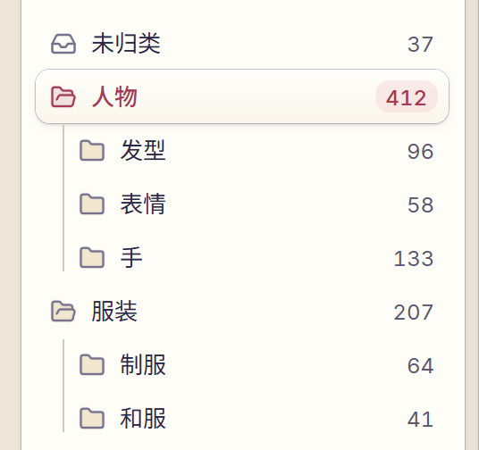 | 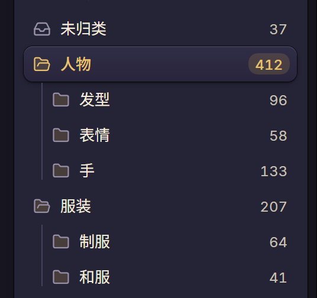 |
| C4e | 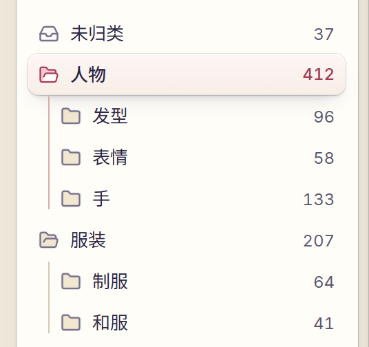 | 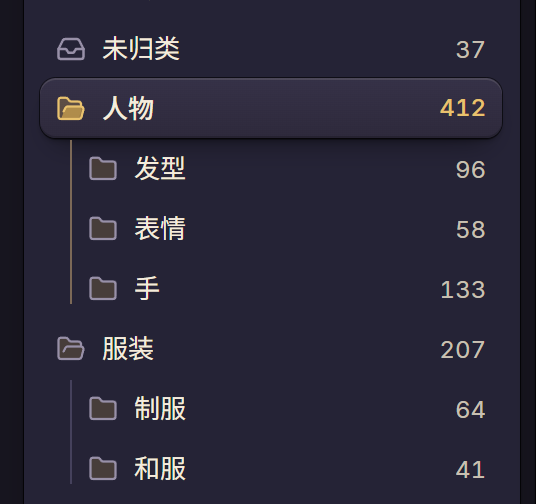 |

令牌（只在 C4e）：

| 令牌 | 日间 | 夜间 |
| --- | --- | --- |
| `--sel-tint` | `--accent` 的 6% | `--accent` 的 3% |
| `--sel-lift` | 墨紫 16% 的半像素线；墨紫 6% 的 1 px 厚度线；`0 2px 3px -1px` 墨紫 10%；`0 8px 14px -8px` 墨紫 24%；上沿白色亮边；下沿墨紫 3.5% | 黑 60% 的半像素线；黑 30% 的厚度线；黑 35%；黑 60%；上沿奶油 12%；下沿黑 18% |
| `--sel-thread` | `--accent` 35% 混 `--line-2` | 同左 |

对比度：名字从强调色回到墨色，对比度升高；张数仍是 `--accent-strong`，底色从胶囊的淡粉变回纸片的面，日夜都不低于 C4d。

没有覆盖的：没有子文件夹的文件夹选中时图标仍是 C4d 的样子（线框加淡底），只有打开的文件夹画两层；“全部图片”“未归类”与图库标题选中时只换了纸片与名字的颜色。

## 第八轮：子文件夹的层级

维护者的意见：C4e 往好的方向走了，下一步推敲子文件夹的层级。为了看第三层，C4f、C4g 的样本里“发型”下面多了“长发”“短发”。

C4e 的子文件夹有四处不对：

- 有子文件夹的文件夹永远展开，收不起来。它的“打开的文件夹”图标只表示“有子文件夹”，点它没有反应。
- 子文件夹的行从左栏最左边铺起，只把字往里挪。选中的纸片、悬停的底都从最左边开始，盖住引线，看不出它在哪一层。
- 引线在最后一个子文件夹下面还多出一截，悬在半空。
- 只有两层，看不出第三层会怎样。

两套共用的改法：

- **折起**：点有子文件夹的文件夹的图标，折起或展开，不选中这一行；键盘在这一行上按 ← 折起、→ 展开。不另加箭头。图标画成两层，后面是夹子，前面一页：展开时翻下来，是纸色；折起时合上，颜色比没有子文件夹的文件夹深一档，看得出里面装着东西。指针停在图标上时，图标先变成点下去之后的样子。前面那一页是同一条路径在变，用的是 C4d 的弹簧。折起的分支里有选中的文件夹时，图标是强调色。
- **缩进**：每深一层，整行往里 16 px。纸片、悬停的底都从这一层开始。
- 折起与展开的动作同图库的展开：合上 0.2 秒，展开时各行依次落下。

两套的差别在怎么画出“这几行属于上面那一个”：

| | C4f「引线」 | C4g「托盘」 |
| --- | --- | --- |
| 怎么画 | 每个子文件夹画自己那一截线，从上一层图标下面开始，最后一个只画到它的中线 | 展开的文件夹下面一块浅浅凹下去的托盘，子文件夹放在里面，没有线 |
| 选中的在哪 | 从上一层一直到选中那一行，每一层的线都染上强调色，再往下不染 | 不标；纸片凸起在凹下去的托盘里，对比本身就清楚 |
| 材质 | 只有 1 px 线，最轻 | 槽的那一族，比查找框浅：`--tray-floor` 加 `--tray-inset` |
| 代价 | 层多的时候几道竖线并排；线很细，夜间不太显 | 每个托盘上下共多占 12 px，层多的时候托盘套托盘；左栏的纸上又多一种面 |

| | 日间 200% | 夜间 200% |
| --- | --- | --- |
| C4f，选中“长发”，“服装”折起 | 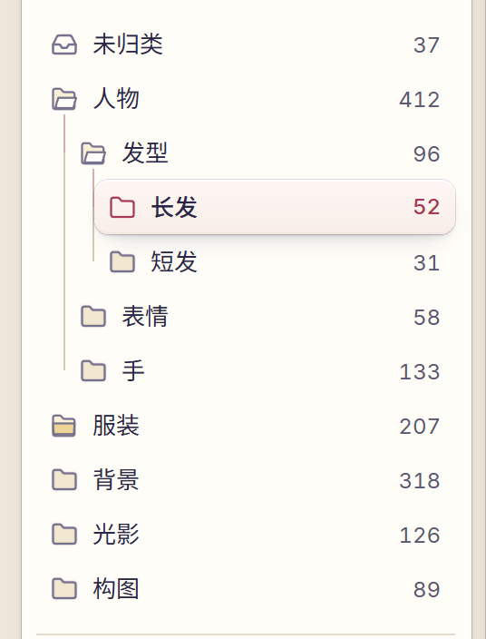 | 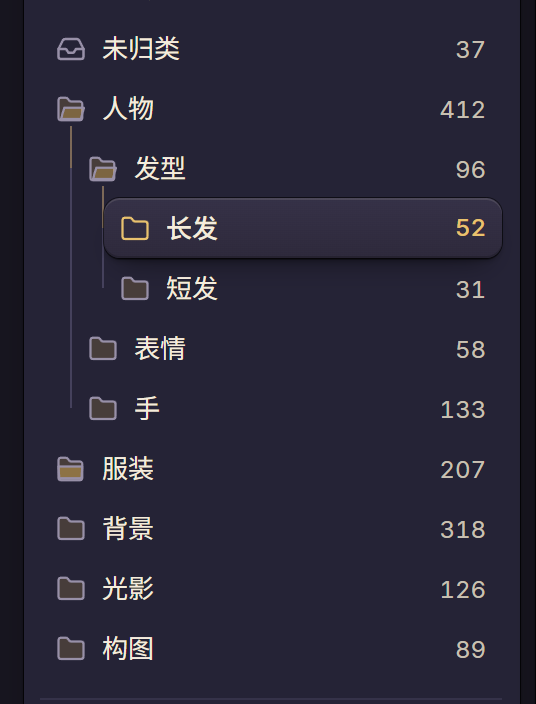 |
| C4f，指针停在“人物”的图标上 | 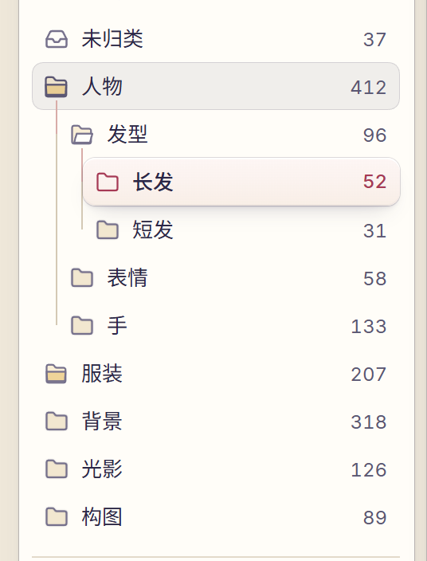 | 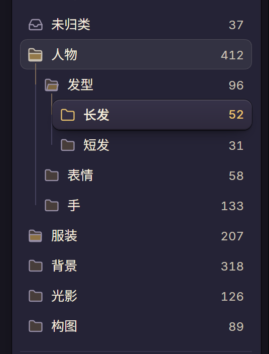 |
| C4g，选中“长发”，“服装”折起 | 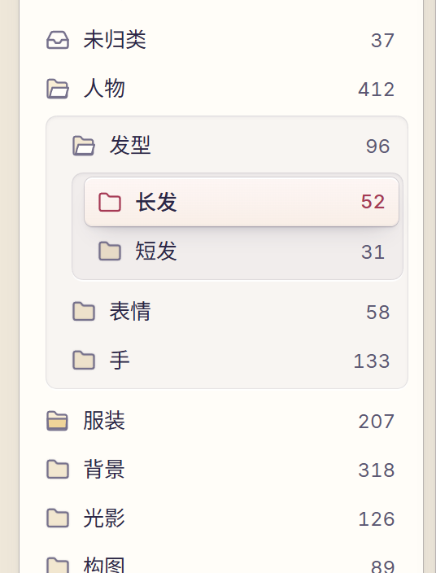 | 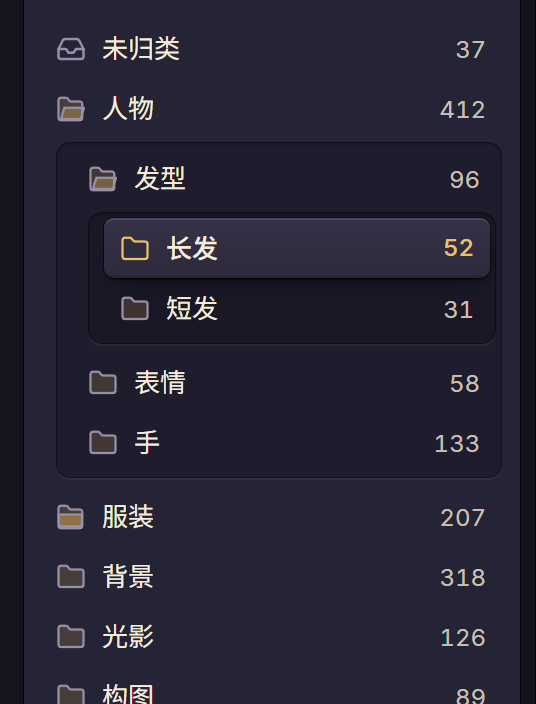 |
| C4g，指针停在“人物”的图标上 | 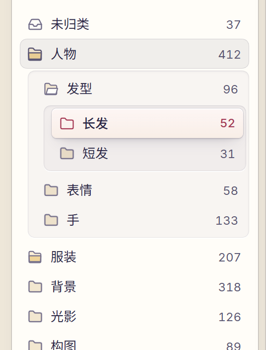 | 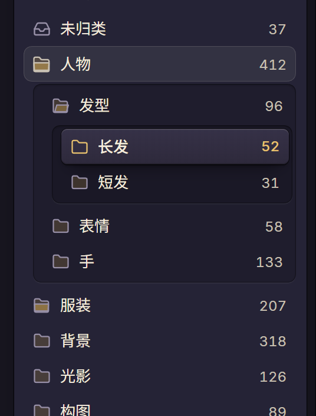 |

录像（1280 × 800 裁出左栏）：折起再展开“服装”与“发型”，选中“长发”，折起再展开“人物”。`shots/c4f-tree-motion-*.webp`、`shots/c4g-tree-motion-*.webp`。

令牌：

| 令牌 | 日间 | 夜间 |
| --- | --- | --- |
| `--tray-floor`（C4g） | 墨紫 3.5% | 黑 16% |
| `--tray-inset`（C4g） | `inset 0 1px 2px` 墨紫 7%；墨紫 8% 的半像素线；下沿外侧白色亮边 90% | 黑 30%；黑 35%；奶油 5% |
| 图标前面一页（合上） | 金 45% | 同左 |

没有覆盖的：

- 正式程序没有“折起文件夹”，折起了哪些只记在原型的内存里，重新打开页面就全部展开。要不要记住、记在哪里，正式实现时再定。
- 拖动时折起的分支里的行不参与（不能拖进折起的文件夹里面的位置）；拖着停在折起的文件夹上不会自动展开。
- 指针停在图标上就变形，从别处划过时也会变一下；没有加延迟。

## 第九轮：折痕（C4h）

维护者的意见：C4f、C4g 都不满意。

两套都是在原来的行上多画一样东西（一道线、一个凹槽），父文件夹本身和普通行没有区别。展开的父文件夹图标是空白的，没有子文件夹的反而有填色，越往上一层看着越轻。C4g 托盘套托盘，张数也不再对齐。另外第八轮一次改了折起、新图标、整行缩进三样，分不出哪一样不对。

这一轮先拼了一张对比图（都以 C4e 为底，每个只改一处）：只靠图标；只在选中的那一组画一道线；折痕。每个各有纸片铺满整行、跟着层级缩进两种。维护者选了“折痕、跟着层级缩进”，就是 C4h。

C4h 沿用第八轮的折起（点图标、← →、两层图标、动作）和整行缩进，改了三处：

- **折痕**：每深一层，子文件夹那一块的左边有一道纸边，一线暗、一线亮，往右 36 px 渐渐淡掉。只有左边，不围成框，所以张数仍然对齐，也不多占高度。选中的文件夹下面不染色。
- **图标**：打开、合上的文件夹和没有子文件夹的用同一种填色，只差前面那一页翻下来还是合上。
- **选中的在哪一支**：选中的那一行往上的各层文件夹，图标带一点强调色，不用线去连。

| | 日间 200% | 夜间 200% |
| --- | --- | --- |
| 选中“长发”，“服装”折起 |  |  |
| 指针停在“人物”的图标上 |  |  |

录像：`shots/c4h-tree-motion-*.webp`，动作同第八轮。

令牌：

| 令牌 | 日间 | 夜间 |
| --- | --- | --- |
| `--crease` | 墨紫 4.5% 往右 36 px 淡到透明 | 黑 22% 往右 36 px 淡到透明 |
| `--crease-edge` | 左边墨紫 10% 一线，里面一线白 | 黑 50% 一线，里面奶油 6% 一线 |
| 祖先的图标 | 线框：强调色 45% 混 `--ink-3`；后面：强调色 16% 混 `--manual-soft`；前面一页纸白 | 线框同左；后面强调色 18%；前面一页强调色 40% |

没有覆盖的：同第八轮（折起只记在内存里；拖动不进折起的分支；悬停就变形，没有延迟）。对比图里的另外两个候选没有留成方案。

## 第十轮：左栏的行（ra–re）

PR #635 把 C4e 的选中纸片做进了正式程序。维护者看了觉得文件夹里还行，放在“全部图片”那一行（直接在纸上、没有托盘）很丑。这一轮只换左栏的行：选中、悬停滑块、按下、文件夹图标，五套叠在 #635 的正式样式上（[rows.css](rows.css)，按 `<html data-rows>` 生效，`data-variant` 记成 `now`，前几轮的样式不参与）。

| | 选中 | 悬停 | 按下 | 文件夹图标 |
| --- | --- | --- | --- | --- |
| 甲 `ra` 指示条 | 平的淡墨底，左边一根 3 × 14 的强调色短条 | 平的，没有边 | 不缩，底深一档 | 只有线框 |
| 乙 `rb` 压槽 | 压进纸里，与查找框同一种槽 | 很浅的平底 | 槽再深一点 | 牛皮纸底 |
| 丙 `rc` 墨块 | 实心墨色块，字翻成纸色 | 平的，没有边 | 缩到 98.5% | 只有线框 |
| 丁 `rd` 荧光笔 | 没有底，名字上涂一道强调色 | 平的，没有边 | 不缩 | 牛皮纸底 |
| 戊 `re` 暖纸 | 深一档的纸色，不用强调色 | 更浅一档 | 不缩，底深一档 | 只有线框 |

**维护者选了甲**，已写进正式程序与 [main-window-material.md](../../ui-system/main-window-material.md)“行”。

| | 日间 | 夜间 |
| --- | --- | --- |
| 选中“全部图片” |  |  |
| 选中第三层的“长发”，指针在“背景”上 |  |  |

重新出图：开着开发服务器，运行 `node design/prototype/main-window-material/row-shots.mjs`。“现状”一栏是运行时 `src/` 里的样子，所以甲写进正式程序之后，它和甲一样。

## 第一轮三套方案共同的结论

- **贴着图片墙的面板不能用投影。** 左栏、分组条、详情栏都贴着图片墙，面板的投影会落在图上，改变参考图边缘的明暗。所以 A、B 的面板之间只有底色与线；想要投影，面板之间就得露出桌面，这就是 C。第一轮的三套方案都没有往图片墙上画任何东西；第二轮的 C2 放宽了这一条，见上。
- **日间靠暗、夜间靠亮。** 日间纸面接近白色，亮边画不出来，深度靠内阴影、半像素暗线与小投影；夜间投影看不见，槽靠更暗的槽底，凸起靠上沿亮边。两个主题的值分别定，不是互为反色。
- **槽底不能变暗（日间）。** 现在查找框里的字在 `--surface` 上。日间把槽底换成更暗的色会降低对比度，所以日间槽的深度只画在槽口；夜间槽底变暗，亮字的对比度反而升高。
- **不新增颜色。** 用到的只有墨紫 `rgba(43, 39, 71)`、奶油 `rgba(244, 236, 220)`、樱粉、金、黑、白的透明度，和 `tokens.css` 已有的令牌。

### 对比度

底色有变化的文字都在下表，其余文字的底色没有变。数值是 WCAG 对比度，由令牌的色值算出；没有一处低于现在。

| 文字 | 现在 | 之后 | 哪套方案 |
| --- | --- | --- | --- |
| 日间：顶栏的张数、分组名（`--ink-2`） | 6.21（`--bg`） | 6.76（`--surface`） | B、C |
| 日间：选中的行（`--accent-strong`） | 5.38（`--accent-soft` 叠 `--surface`） | 5.79–6.20（`--btn-face`） | C |
| 夜间：左栏与详情栏的字（`--ink`） | 13.03（`--surface`） | 14.22（`--bg`） | B |
| 夜间：左栏的张数（`--ink-2`） | 8.48（`--surface`） | 9.25（`--bg`） | B |
| 夜间：查找框的提示字（`--ink-2`） | 8.48（`--surface`） | 9.72（`--sunken`） | A、B、C |
| 夜间：查找框里输入的字（`--ink`） | 13.03（`--surface`） | 14.93（`--sunken`） | A、B、C |
| 夜间：选中的行（`--accent-strong`） | 6.50（`--accent-soft` 叠 `--surface`） | 7.13（B）、7.79–8.75（C） | B、C |

## 令牌的值

写法与 `src/styles/tokens.css` 相同：`light-dark(日间, 夜间)`。完整的值在 [variants.css](variants.css)。

### 槽（三套共用，B 深一档）

| 令牌 | 日间 | 夜间 |
| --- | --- | --- |
| `--well-floor` | `--surface` | `--sunken` |
| `--well-inset` 上沿暗边 | `inset 0 1px 0` 墨紫 8%（B 12%） | 黑 30%（B 40%） |
| `--well-inset` 内阴影 | `inset 0 2px 3px -1px` 墨紫 14%（B：`0 3px 5px -1px` 20%） | 黑 50%（B 60%） |
| `--well-inset` 一圈线 | `inset 0 0 0 0.5px` 墨紫 30%（B 34%） | 黑 70%（B 75%） |
| `--well-inset` 下沿亮边 | `0 1px 0` 白 90% | 奶油 7% |
| `--well-inset-hover` | 一圈线加深到墨紫 48%（B 52%），内阴影略加深 | 一圈线换成奶油 24%（B 26%），内阴影略加深 |

聚焦不变：2 px `--accent` 焦点环（`--focus-ring`）。

### A

| 令牌 | 日间 | 夜间 |
| --- | --- | --- |
| `--sel-edge` | `inset 0 0 0 0.5px` 樱粉 50% | 金 42% |

### B

| 令牌 | 日间 | 夜间 |
| --- | --- | --- |
| `--chrome` | `--surface` | `--bg` |
| `--groove-dark` | 墨紫 16% | 黑 60% |
| `--groove-light` | 白 90% | 奶油 7% |
| `--pressed-hover` | `inset 0 1px 0` 墨紫 6%、`inset 0 2px 3px -1px` 墨紫 14%、`0 1px 0` `--groove-light` | 黑 30%、黑 45%、`--groove-light` |
| `--pressed-on` | `inset 0 1px 0` 深樱粉 16%、`inset 0 2px 3px -1px` 深樱粉 30%、`inset 0 0 0 0.5px` 樱粉 30%、`0 1px 0` `--groove-light` | 黑 35%、黑 50%、金 28%、`--groove-light` |

### C

| 令牌 | 日间 | 夜间 |
| --- | --- | --- |
| `--desk` | `--rail` | `--rail` |
| `--sheet-gap` | 8 px | 8 px |
| `--sheet-main` 主区的纸 | `--surface` | `--bg` |
| `--sheet-lift` | `0 0 0 0.5px` 墨紫 22%、`0 1px 2px` 墨紫 10%、`0 6px 16px -6px` 墨紫 14% | 黑 75%、黑 45%、黑 40% |
| `--sheet-top` | `inset 0 1px 0` 白 90% | 奶油 9% |

选中的行直接用 `--btn-face` 与 `--btn-lift`，不另设令牌。

## 截图

在 [shots/](shots/)，文件名是 `<方案>-<内容>-<day|night>.webp`，`now` 是现状。共 100 张：

- `1280x800`、`1920x1080`：整屏，日间、夜间各一张，每个版本都有。左栏选中“人物”，指针停在“服装”上，详情栏收起。
- `1280x800-inspector`：同上，详情栏打开、没有选图，每个版本都有。`c4a`、`c4b`、`c4c` 的其余整屏图里选了“蓝发”“红瞳”，这一张没有查找条件。
- `zoom`：200%，左栏上半段（选中的一行、悬停的一行）与查找框的左半。只有 `now`、`a`、`b`、`c`、`c4`，其余版本的材质与 C、C4 相同。
- `specimen`：200%，材质样本。只有 `now`、`a`、`b`、`c`。
- `search`：200%，查找框选中的样子。只有 `c4c`、`c4d`。
- `drag`、`drag-into`：200%，拖动文件夹时的两个时刻（落在两行之间、放进一个文件夹）。只有 `c4d`。
- `motion`：一段会动的录像（换选中的行、拖动、收起与展开、点进查找框）。只有 `c4d`。

| | 日间 1280 × 800 | 夜间 1280 × 800 |
| --- | --- | --- |
| 现状 |  |  |
| A |  |  |
| B |  |  |
| C |  |  |

| | 日间 200% | 夜间 200% |
| --- | --- | --- |
| 现状 |  |  |
| A |  |  |
| B |  |  |
| C |  |  |

| | 日间材质样本 | 夜间材质样本 |
| --- | --- | --- |
| 现状 |  |  |
| A |  |  |
| B |  |  |
| C |  |  |

材质样本里的分段控件（槽加凸起的一段）只为对照同一族的东西放在一起是什么样，不在这次要定的范围里。

重新出图：开着开发服务器，运行 `node design/prototype/main-window-material/shots.mjs`。脚本用本机的 Edge 无界面运行，不装依赖；录像要本机有 ffmpeg，没有就跳过。

## 没有覆盖的

- 只看了浏览图片这一屏。设置、对话框里的 `.k-input` 与 `.k-select` 会跟着换材质，这次只在材质样本里看过。
- 截图来自 Edge，不是装好的程序；内核相同，字体与样式表是同一份。没有在 125%、150% 缩放下看过半像素线。
- 动作只做了文件夹视图（第六轮）。图片墙、查找条件、分组面板、详情栏的动作没有动。
- 原型自己写的部件（[Groups.tsx](Groups.tsx)、[Folders.ts](Folders.ts)、[Switcher.tsx](Switcher.tsx)）里的文字是直接写在代码里的，只有中文。#606 要求不改 `src/`，所以没有往 `src/i18n/locales` 里加。正式实现时这些文字（按钮名、悬停提示、读给读屏用户的移动结果）要进语言文件，能用现有分组文字的就用现有的。
