# 主界面质感原型（#606）

一次性原型，回答一个问题：**查找框、左栏的行、面板之间，各用什么材质。** 第一轮给出三套方案（A、B、C），维护者选了 C；之后三轮都在 C 上改：第二轮把占掉的图片墙面积找回来（C2、C3），第三轮把底色改回米黄、详情栏默认收起（C4、C5），第四轮重做标签分组（C4a、C4b）。**现在的方向是 C4。** 方案定下来之后，规则另开文档 PR 写进 `design/ui-system/`。这里的代码不进正式程序。

## 怎么看

仓库根目录运行（需要先 `npm ci`）：

```bash
npx vite --config design/prototype/main-window-material/vite.config.ts
```

打开 <http://127.0.0.1:1431/design/prototype/main-window-material/?variant=a>。底部的墨色切换条换方案（键盘 ← →）、换日夜、开关材质样本。

| 参数 | 值 |
| --- | --- |
| `variant` | `now` 现状、`a`、`b`、`c`，第二轮的 `c2`、`c3`，第三轮的 `c4`、`c5`，第四轮的 `c4a`、`c4b` |
| `inspector=1` | 打开详情栏；不写时收起，与正式程序的默认相同 |
| `theme` | `light`、`dark`；不写跟随系统 |
| `specimen=1` | 显示材质样本：输入框、下拉与已定材质的按钮、滑条、分段排在一起 |
| `bar=0` | 藏起切换条（截图用） |

页面上运行的是正式程序的 `<App />`：组件与样式表从 `src/` 原样引用，所以尺寸与正式程序一致，侧栏、查找框、菜单都能操作。后端换成 [backend.ts](backend.ts) 的样本数据，图片是开发服务器生成的色块。三套方案只是叠在最后的一张样式表 [variants.css](variants.css)，`src/` 没有改动。启动加载页在原型里藏起来了。

## 三套方案的四个回答

| | A 槽 | B 刻 | C 叠 |
| --- | --- | --- | --- |
| 一句话 | 面板不动，材质只加在控件上 | 界面是一整块板，分界是刻线，状态往下压 | 面板是三张纸，之间露出桌面，状态往上浮 |
| **1 输入类控件** | 槽：槽口上沿一线暗边、落进来的内阴影、一圈半像素线、下沿外侧一道亮边。日间槽底仍是 `--surface`，夜间改用更暗的 `--sunken` | 同一种槽，内阴影深一档（3 px 对 2 px） | 与 A 相同的槽，压在纸上 |
| **2 行的悬停与选中** | 悬停不变（平的 `--hover`）。选中是平的强调色浅底，加一圈半像素线。**与 dock 的选中块是同一种东西**，图标轨的当前项也是 | 悬停是浅凹（`--hover` 底加内阴影）。选中是强调色的浅槽，与精确查找开启时同一族。**与 dock 的选中块不是一种东西**：dock 是浮着的玻璃，上面的色块是平的；板上的行是压下去的 | 悬停不变。选中是一张凸起的小纸片：按钮的面与投影（`--btn-face`、`--btn-lift`），字仍是强调色。**与 dock 的选中块不是一种东西**，与按钮是一种东西 |
| **3 面板的前后** | 底色两档加 1 px 线，与现在相同。不用投影 | 底色：左栏、顶栏、分组条、详情栏同一个底色，图标轨深一档，图片墙是板上开的窗。线：刻线，一道暗线旁边一道亮线。不用投影 | 底色：桌面（`--rail`）与纸两档。投影：三张纸各有半像素线、近处一层小投影、上沿亮边，落在 8 px 的桌面上。线：只留纸内部的 1 px 线 |
| 分组条 | 不变：与顶栏同底，下沿一条线 | 与顶栏并成一条，和两侧栏同底，下沿是板的边 | 与顶栏在同一张纸上，图片墙在纸的下半 |
| **4 令牌** | `--well-floor`、`--well-inset`、`--well-inset-hover`、`--sel-edge` | A 的三个 `--well-*`，加 `--chrome`、`--groove-dark`、`--groove-light`、`--pressed-hover`、`--pressed-on` | A 的三个 `--well-*`，加 `--desk`、`--sheet-gap`、`--sheet-main`、`--sheet-lift`、`--sheet-top` |

### 各方案改了什么、代价是什么

- **A**：只动查找框、`.k-input`、`.k-select` 和选中块的一圈线。面板“没有前后关系”这一条没有解决，只是定下来：贴边的面板靠底色与线，前后关系留给浮着的东西。改动最小，#607、#608 几乎不受影响。
- **B**：日间顶栏与分组条从米黄（`--bg`）换成纸白（`--surface`），夜间左栏与详情栏从 `--surface` 换成更暗的 `--bg`，所以两个主题下都是一整块。日间板是纸白，亮线看不见，刻线只剩一道暗线；夜间才是完整的一暗一亮。悬停块有了内阴影，滑动时比现在重一点。
- **C**：三张纸之间和窗口四周各留 8 px，详情栏打开时图片墙因此变窄 24 px、变矮 16 px。面板有了 12 px 圆角，图片墙的下面两个角跟着纸的圆角裁掉。夜间主区的纸（`--bg`）比两侧的纸（`--surface`）暗一档，三张纸不是同一个底色，原因见下面“对比度”。窗口最大化时四周也留着 8 px 桌面。

## 第二轮：C 的整体迭代

维护者的意见（2026-11-14）：C 最好看；面板浮起来之后可以用投影；占图片墙面积的问题靠迭代整体设计解决。C 的材质（槽、凸起的选中行、纸的投影与亮边）不变，变的是谁做桌面。

| | C 叠 | C2 墙做桌面 | C3 墙做桌面，顶栏一行 |
| --- | --- | --- | --- |
| 桌面 | 图标轨的米黄（`--rail`） | 图片墙的中性灰（`--wall`） | 同 C2 |
| 图片墙 | 在主区那张纸里，四周被间隙扣掉 | 就是桌面，从窗口顶铺到窗口底；三张纸浮在它上面 | 同 C2 |
| 纸 | 左栏、主区（顶栏加分组条加图片墙）、详情栏 | 左栏、顶栏加分组条、详情栏 | 同 C2；主区宽 1100 px 起，分组条并进顶栏那一行 |
| 图片墙比现在（1280 × 800，详情栏开着） | 窄 24 px、矮 16 px | 一样宽，矮 8 px | 窄窗口同 C2 |
| 图片墙比现在（1920 × 1080，详情栏开着） | 窄 24 px、矮 16 px | 一样宽，矮 8 px | 一样宽，高 33 px |
| 投影落在哪 | 桌面上 | 图片墙上：两侧落在墙边 12 px 的留白里，碰不到图；顶栏那张纸的投影落在滑到它下沿的图上 | 同 C2 |

C2 怎么把面积找回来的：

- 纸与纸之间的 8 px 间隙就是图片墙本身，不再是从图片墙里扣出来的米黄桌面。
- 详情栏右边的 8 px 桌面算在它自己的宽度里（320 = 纸 312 + 桌面 8），图片墙的宽度与现在相同。
- 图片墙的上沿藏在顶栏那张纸下面 12 px，图片从纸的圆角后面滑出来。

C2、C3 要知道的：

- **界面的底从米黄变成中性灰。** 米黄只留在纸上（`--surface`）。日间 `--rail` 与 `--wall` 明度接近，整体只是少了一点暖色；夜间两者本来就几乎一样。图标轨的图标直接放在灰底上。
- **顶栏的投影会落在图上。** 这是唯一画到图片上的东西：图滑到顶栏下沿时，最上面约 10 px 会被一层很淡的投影压暗。不接受的话，顶栏那张纸改用半像素线、不用投影。
- **夜间顶栏那张纸（`--bg`）比两侧的纸（`--surface`）暗一档**，原因同 C：顶栏的字现在就在 `--bg` 上，换亮会降低对比度。
- **C3 只是摆给人看的。** 原型用 CSS 锚点定位把分组条摆进顶栏那一行，没有改组件；分组多到一行放不下时怎么收，没有做；查找框的最大宽度从 960 px 收到了 480 px。这些是 #607（顶栏的呈现）的事。
- 第一轮的对比度表对 C2、C3 同样成立：文字的底色与 C 相同。

| | 日间 1280 × 800，详情栏打开 | 夜间 1280 × 800，详情栏打开 |
| --- | --- | --- |
| C | 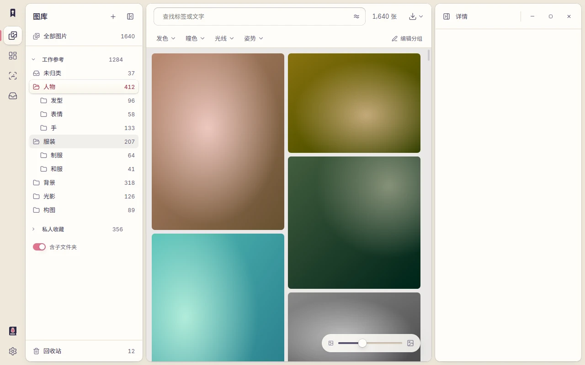 | 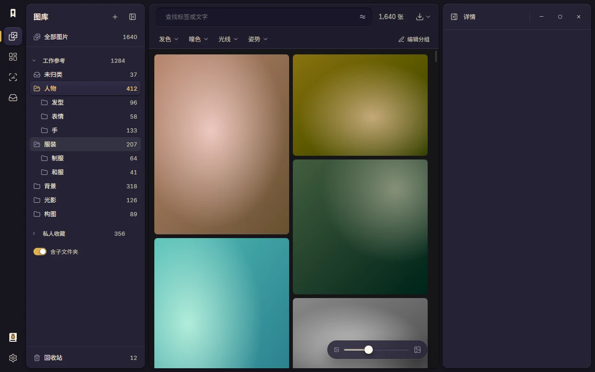 |
| C2 | 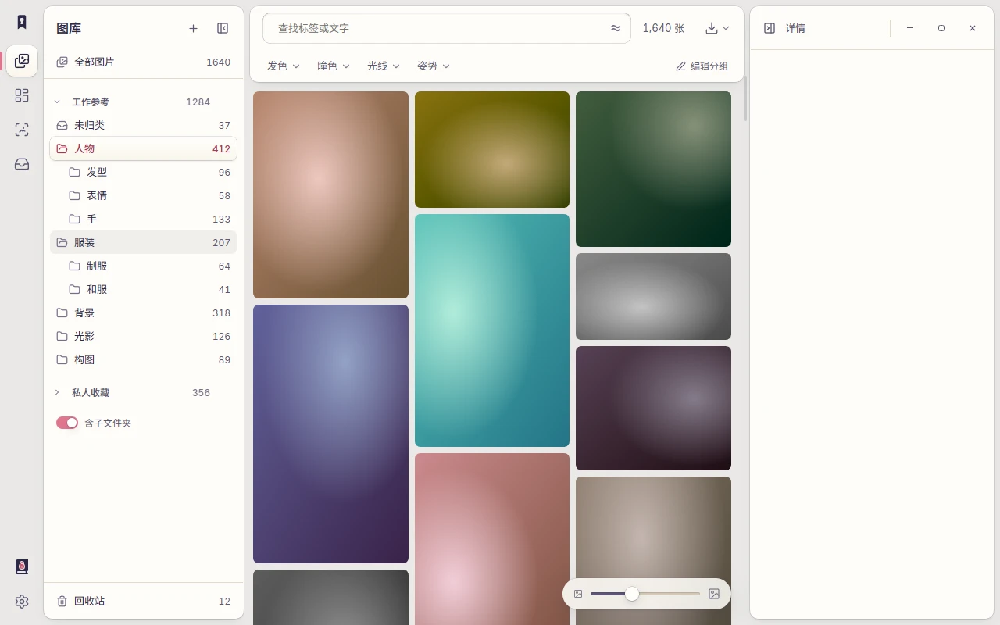 | 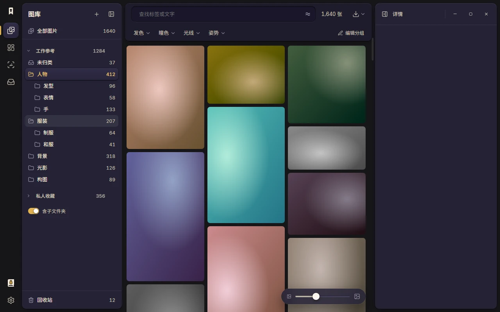 |

| | 日间 1920 × 1080 | 夜间 1920 × 1080 |
| --- | --- | --- |
| C2 | 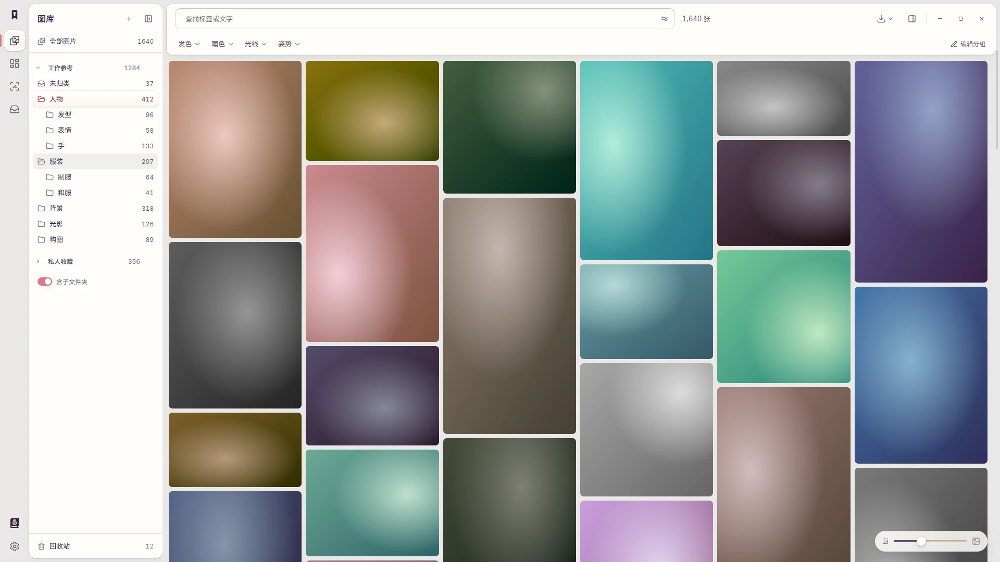 | 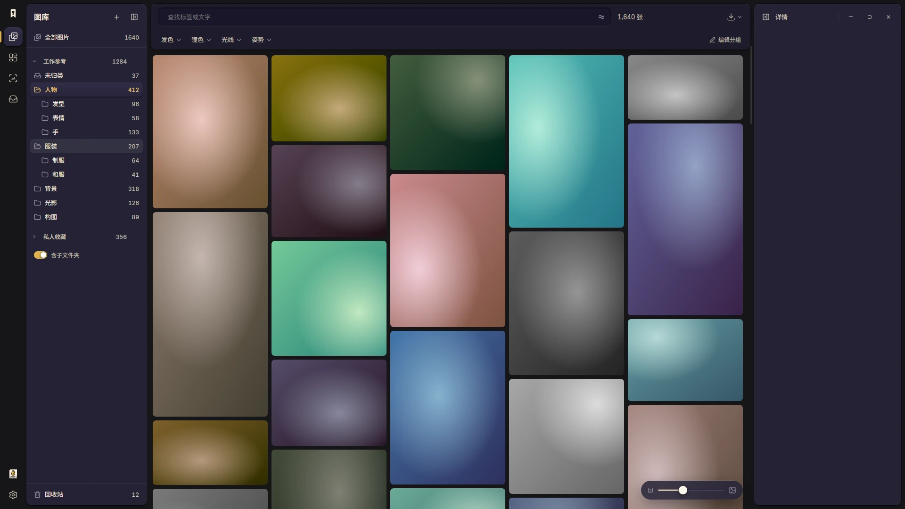 |
| C3 |  | 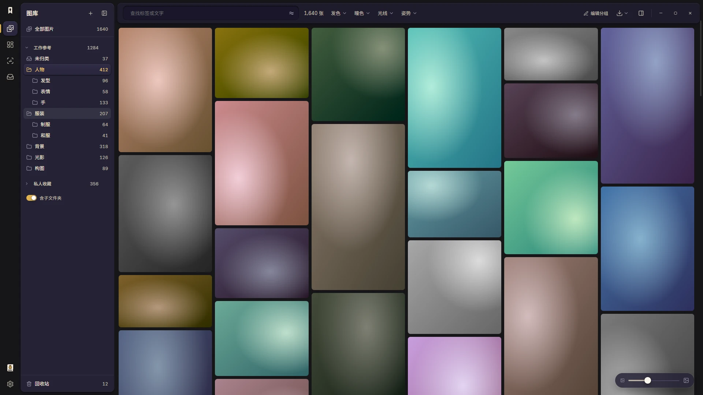 |

C2、C3 比 C 多改的令牌只有一个：`--desk` 从 `--rail` 换成 `--wall`。

## 第三轮：米黄桌面，详情栏默认收起

维护者的意见（2026-11-14）：C2 不错，但灰底与米黄衔接得奇怪，画师也反馈过更喜欢温暖的米黄；详情栏现在不重要，不必默认弹出。

- **详情栏**：正式程序里它本来就默认收起、只由画师亲手打开（工具栏按钮或 I 键），打开与否记在本机设置里。前两轮的截图里它开着，是原型的样本数据按 #606“空的详情栏”设的。这一轮起原型默认收起，所有整屏截图都是收起的样子，另出一张打开的（`*-1280x800-inspector-*`）。收起之后，平时的界面是两张纸：左栏与主区。
- **底色**：图片墙必须是中性灰（不给参考图染色），桌面要米黄，所以图片墙不能再做桌面，它得有自己的边界。C4 让它回到主区那张纸里，和 C 一样。

| | C 叠 | C4 米黄桌面 | C5 纸铺到边 |
| --- | --- | --- | --- |
| 桌面 | 米黄（`--rail`） | 同 C | 同 C |
| 主区那张纸 | 四周各留 8 px | 同 C | 铺到窗口的右边与下边，只留左上的圆角；详情栏打开时右上也是圆角 |
| 左栏 | 256 的纸，右边另留 8 px | 256 = 纸 248 + 桌面 8 | 同 C4 |
| 详情栏（打开时） | 320 的纸，左右各另留 8 px | 320 = 桌面 8 + 纸 312，右边另留 8 px | 同 C4 |
| 顶栏 | 两行 | 主区宽 1100 px 起并成一行（同 C3） | 同 C4 |
| 图片墙比现在（1280 × 800） | 窄 16 px、矮 16 px | 窄 8 px、矮 16 px | 一样宽，矮 8 px |
| 图片墙比现在（1920 × 1080） | 窄 16 px、矮 16 px | 窄 8 px、高 25 px | 一样宽，高 33 px |

上表按详情栏收起算。投影都落在桌面上，图片墙上不画东西，第一轮“贴着图片墙的面板不能用投影”那一条在 C4、C5 里仍然成立。

要知道的：

- **前两轮说的“三列变两列”不是结构问题。** 列数是图片墙宽度除以画师选的图片大小再取整，哪种宽度下都会有一个临界点；那张截图恰好踩在上面。真正的代价只是上表里的像素数。
- **左栏的纸窄了 8 px**（248），里面的行跟着窄 8 px，样本数据里没有文字被截断。
- **C5 的纸不再是“浮着的一张”**：它的右边和下边贴着窗口，看起来更像桌面右下铺开的一大张。换来的是图片墙与现在一样宽。
- 顶栏并成一行仍是用 CSS 锚点定位摆的，没有改组件（同 C3 的说明）。

| | 日间 1280 × 800 | 夜间 1280 × 800 |
| --- | --- | --- |
| C4 | 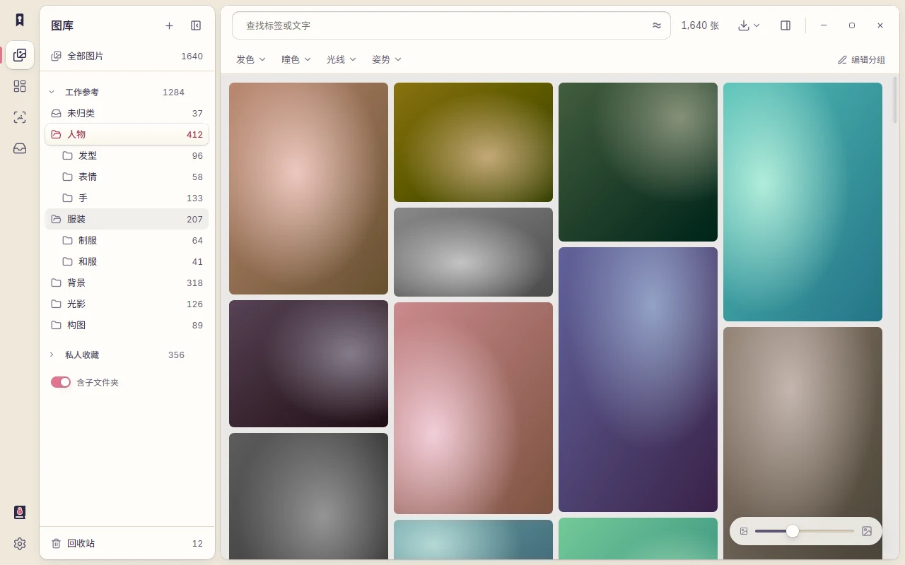 |  |
| C4，详情栏打开 | 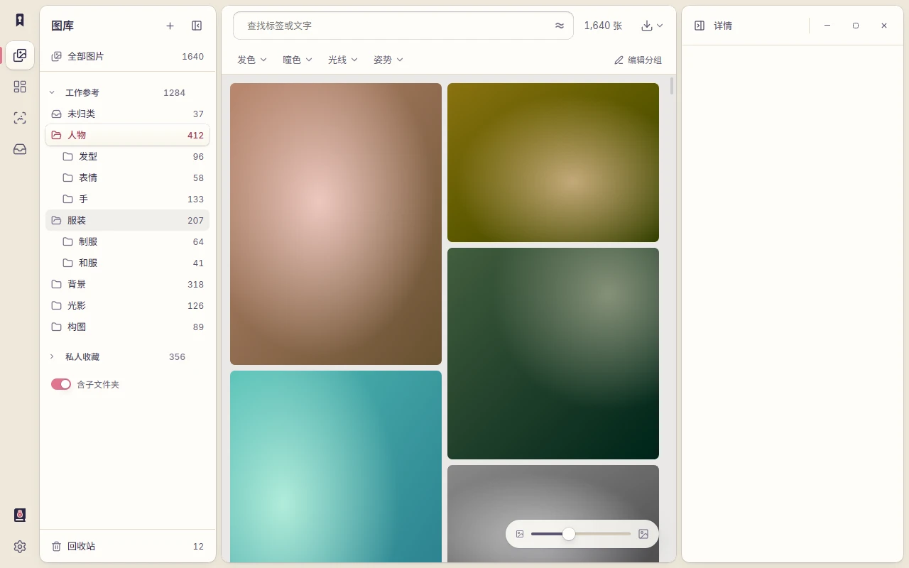 | 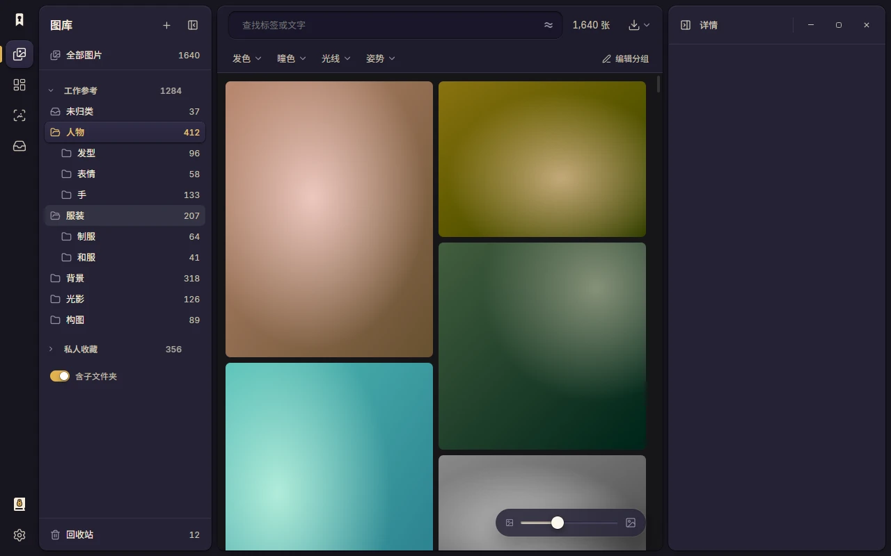 |
| C5 | 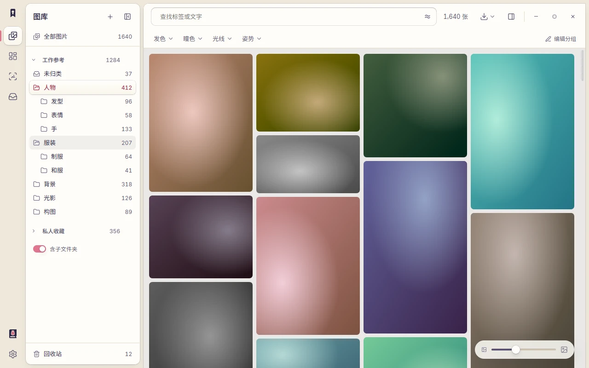 | 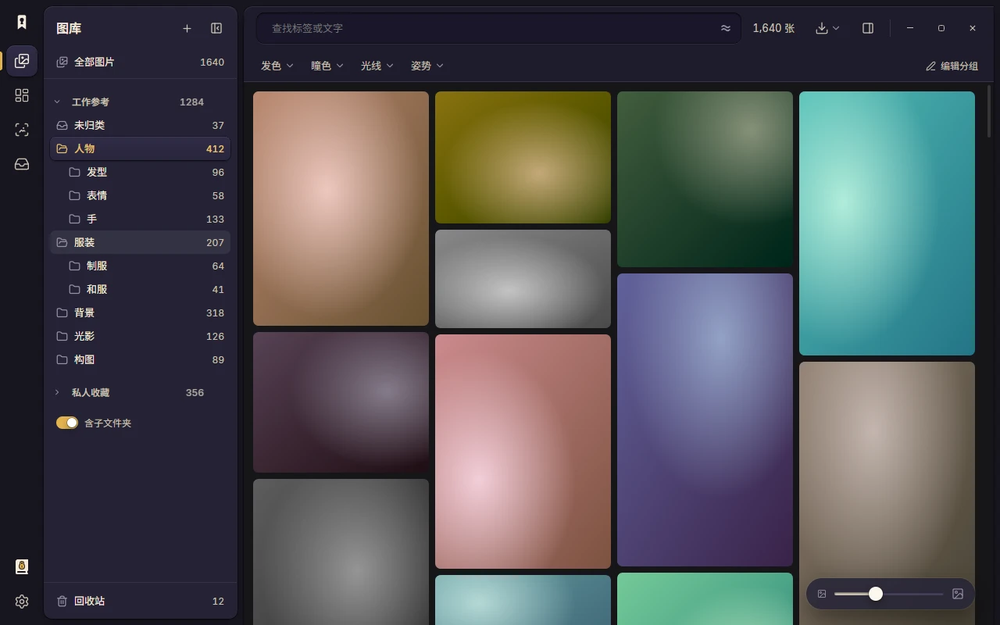 |

| | 日间 1920 × 1080 | 夜间 1920 × 1080 |
| --- | --- | --- |
| C4 |  |  |
| C5 | 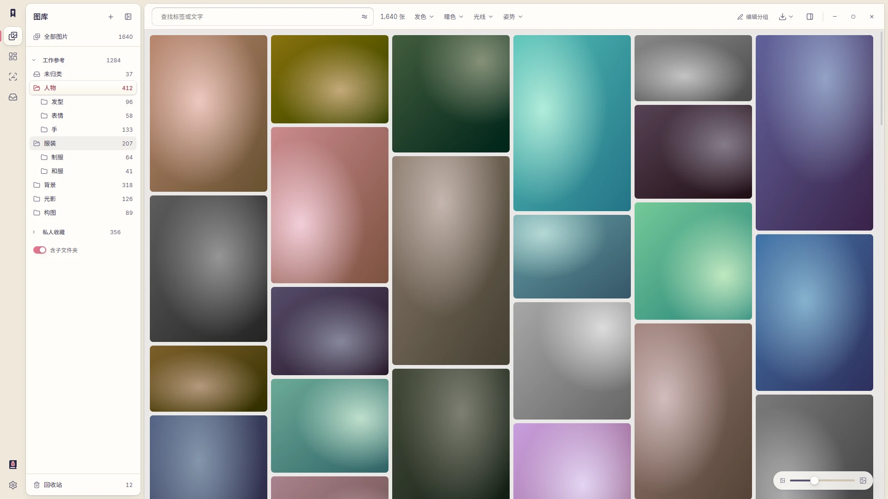 | 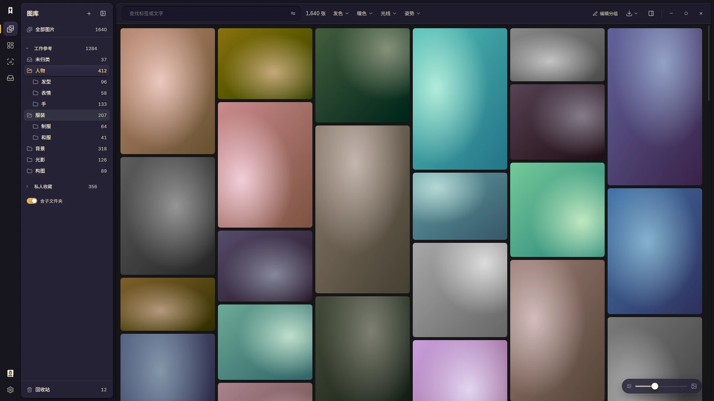 |

| | 日间 200% | 夜间 200% |
| --- | --- | --- |
| C4 | 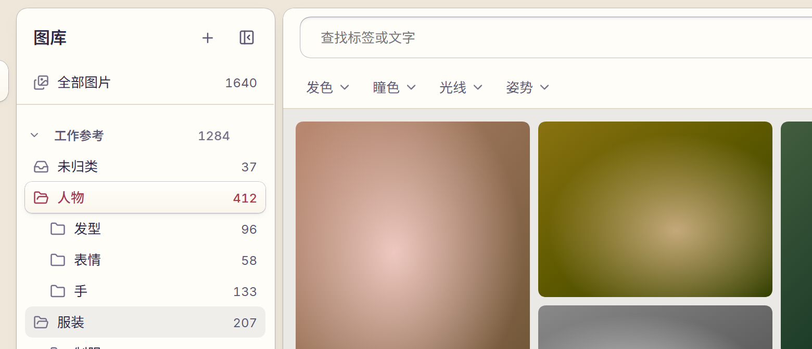 | 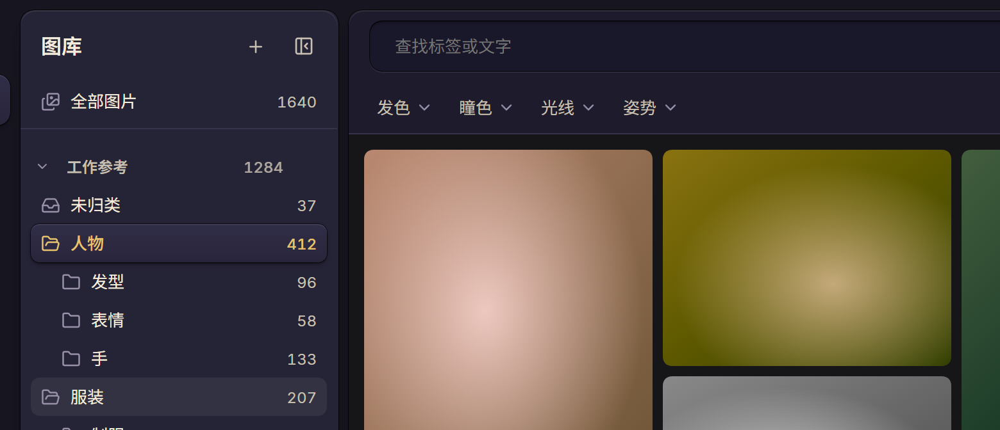 |

## 第四轮：标签分组与“编辑分组”

维护者的意见（2026-11-14）：C4 不错；标签分组和“编辑分组”要彻底调整。

现在的分组条是顶栏下面单独的一行：几个分组名靠左，“编辑分组”靠最右，中间是空的；每个分组各开一个浮层，跨两个分组选标签要开两次。两种新摆法都取消这一行，顶栏在任何宽度下都只有一行，都接在正式程序的查找条件上（选了标签，查找框里出现真的条件，可以在那里去掉或排除）。

| | C4（第三轮） | C4a 分组进查找 | C4b 分组进左栏 |
| --- | --- | --- | --- |
| 分组在哪 | 顶栏下面一行；主区宽 1100 px 起并进顶栏 | 查找框后面一个“分组”按钮，点开一块面板 | 左栏滚动区里的一段，在图库下面 |
| 怎么选 | 点分组名开浮层，再点标签；每个分组一个浮层 | 面板里所有分组的标签一次摆出来，可以跨分组连选，面板不关 | 展开分组，点标签那一行；选中的行是凸起的小纸片 |
| 选了几个 | 分组名后面的数字 | “分组”按钮上的数字，面板里的标签变色 | 分组那一行的数字，标签行凸起 |
| 任一成员 | 浮层顶上的按钮 | 指针移到分组上时，分组名右边出现 | 没有做 |
| 编辑分组 | 分组条最右的文字按钮 | 面板底部的一行 | “标签分组”标题行悬停时出现的笔形按钮 |
| 图片墙比现在（1280 × 800） | 窄 8 px、矮 16 px | 窄 8 px、高 25 px | 同 C4a |
| 图片墙比现在（1920 × 1080） | 窄 8 px、高 25 px | 窄 8 px、高 25 px | 同 C4a |

要知道的：

- **C4a 的代价是分组名不再常驻。** 平时只看得到“分组”两个字，分组名要点开才有。点击次数没有变多：现在是点分组、点标签两下，C4a 是点“分组”、点标签两下；跨分组选第二个标签时现在要再开一个浮层，C4a 只多一下。
- **C4b 的代价是左栏变长。** 图库展开、文件夹多的时候，分组会被挤到滚动区下面（1280 × 800 的截图里只露出第一个分组，第二个要滚动才看得到）。左栏原本只管“看哪里”（浏览范围），分组是“筛什么”，两样东西放进了同一栏。#98 当时把分组的编辑从左栏移了出去，C4b 等于把分组的使用放回左栏。
- **两种摆法里“编辑分组”都退到第二层。** 它不是每次查找都要用的东西，不再占顶栏的位置。点它打开的仍是正式程序的“编辑分组”对话框。
- 顺带做了 #607 的两项，这两个版本里才有：查找框开头加了查找图标，最大宽度从 960 px 收到 560 px。张数与导入的位置没有动。
- 原型里的分组面板与左栏分组是原型自己写的组件（[Groups.tsx](Groups.tsx)），从正式程序分组条的 React 节点上读查找条件，正式实现时要重写。分组多到面板放不下时面板内部滚动；左栏里分组多时跟着左栏滚动。

| | 日间 1280 × 800 | 夜间 1280 × 800 |
| --- | --- | --- |
| C4a，面板打开，选了“蓝发”“红瞳” | 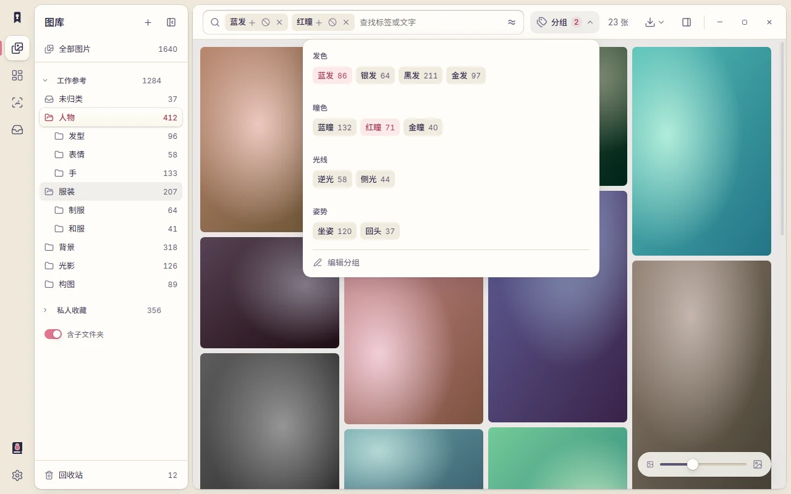 | 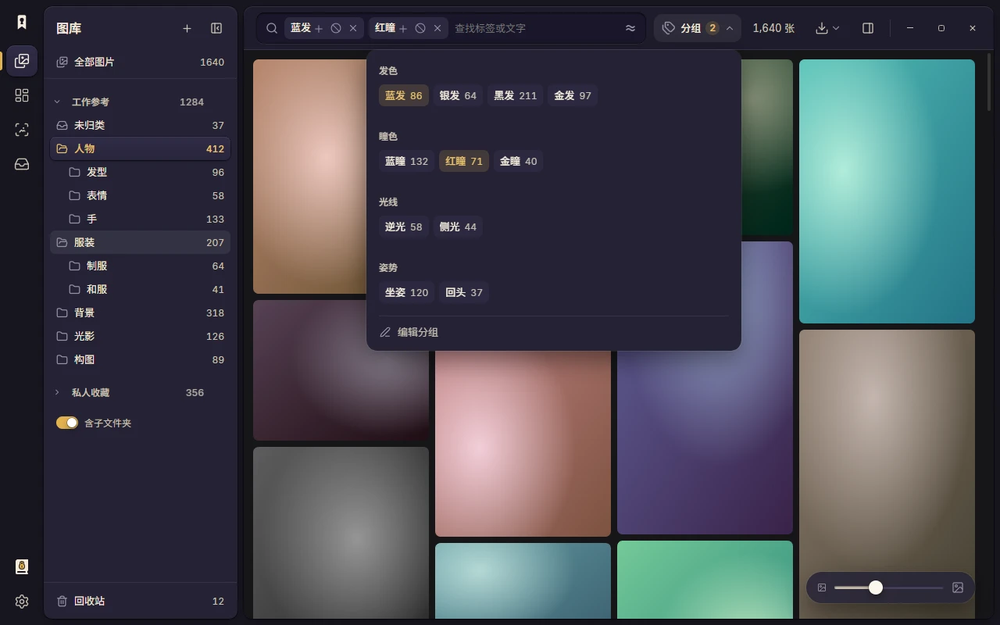 |
| C4b，展开“发色”“瞳色” | 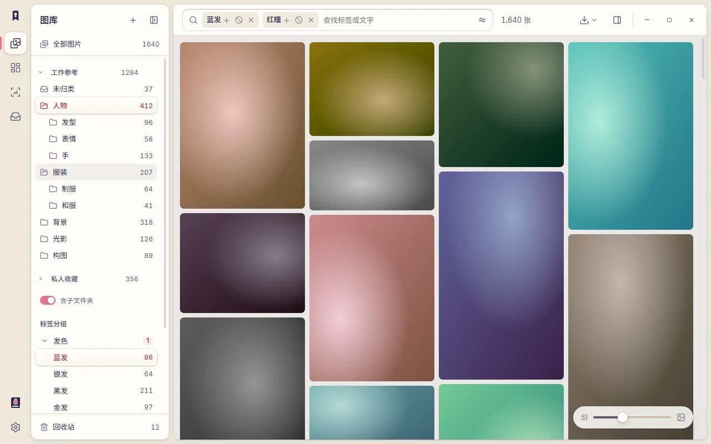 | 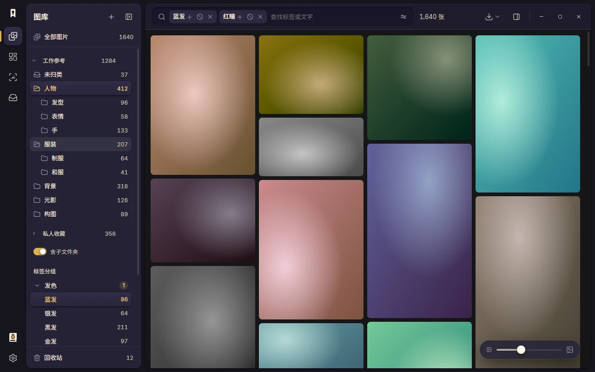 |

| | 日间 1920 × 1080 | 夜间 1920 × 1080 |
| --- | --- | --- |
| C4a | 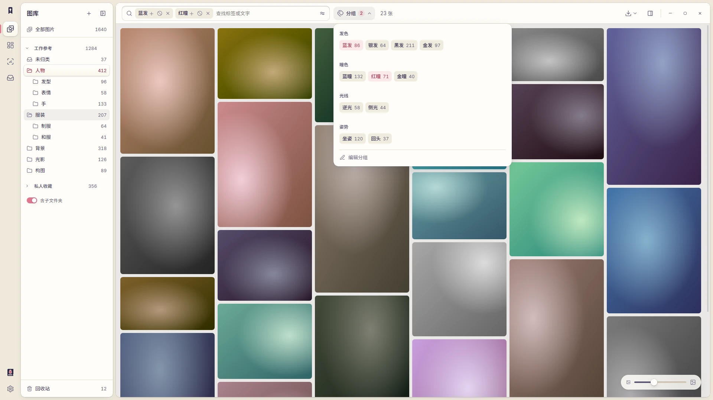 | 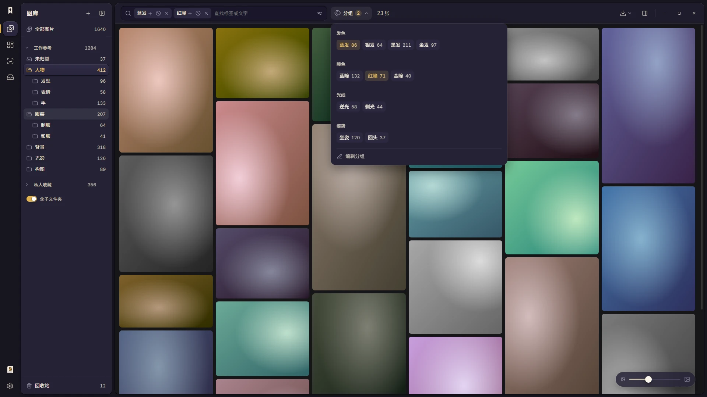 |
| C4b |  | 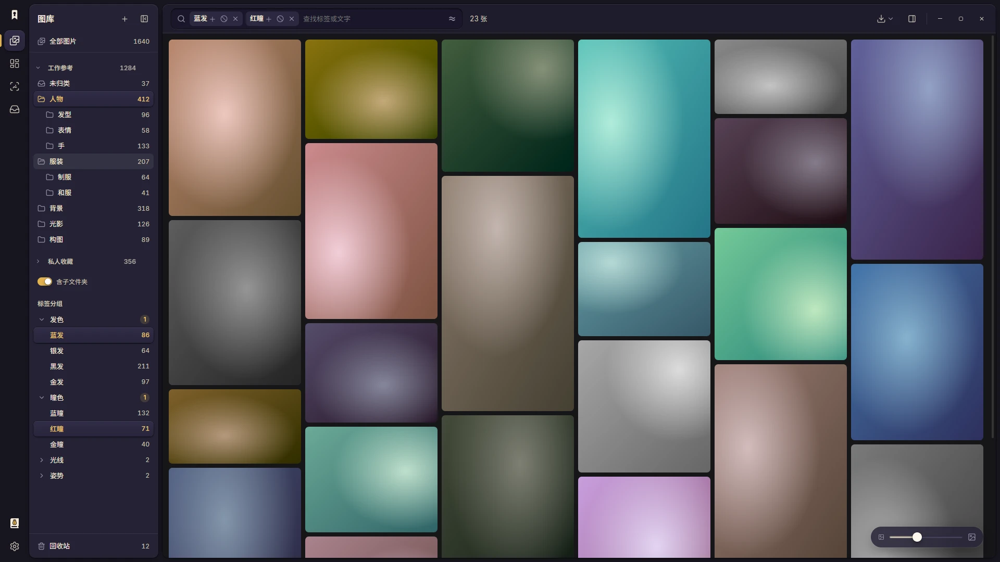 |

## 第一轮三套方案共同的结论

- **贴着图片墙的面板不能用投影。** 左栏、分组条、详情栏都贴着图片墙，面板的投影会落在图上，改变参考图边缘的明暗。所以 A、B 的面板之间只有底色与线；想要投影，面板之间就得露出桌面，这就是 C。第一轮的三套方案都没有往图片墙上画任何东西；第二轮的 C2 放宽了这一条，见上。
- **日间靠暗、夜间靠亮。** 日间纸面接近白色，亮边画不出来，深度靠内阴影、半像素暗线与小投影；夜间投影看不见，槽靠更暗的槽底，凸起靠上沿亮边。两个主题的值分别定，不是互为反色。
- **槽底不能变暗（日间）。** 现在查找框里的字在 `--surface` 上。日间把槽底换成更暗的色会降低对比度，所以日间槽的深度只画在槽口；夜间槽底变暗，亮字的对比度反而升高。
- **不新增颜色。** 用到的只有墨紫 `rgba(43, 39, 71)`、奶油 `rgba(244, 236, 220)`、樱粉、金、黑、白的透明度，和 `tokens.css` 已有的令牌。

### 对比度

底色有变化的文字都在下表，其余文字的底色没有变。数值是 WCAG 对比度，由令牌的色值算出；没有一处低于现在。

| 文字 | 现在 | 之后 | 哪套方案 |
| --- | --- | --- | --- |
| 日间：顶栏的张数、分组名（`--ink-2`） | 6.21（`--bg`） | 6.76（`--surface`） | B、C |
| 日间：选中的行（`--accent-strong`） | 5.38（`--accent-soft` 叠 `--surface`） | 5.79–6.20（`--btn-face`） | C |
| 夜间：左栏与详情栏的字（`--ink`） | 13.03（`--surface`） | 14.22（`--bg`） | B |
| 夜间：左栏的张数（`--ink-2`） | 8.48（`--surface`） | 9.25（`--bg`） | B |
| 夜间：查找框的提示字（`--ink-2`） | 8.48（`--surface`） | 9.72（`--sunken`） | A、B、C |
| 夜间：查找框里输入的字（`--ink`） | 13.03（`--surface`） | 14.93（`--sunken`） | A、B、C |
| 夜间：选中的行（`--accent-strong`） | 6.50（`--accent-soft` 叠 `--surface`） | 7.13（B）、7.79–8.75（C） | B、C |

## 令牌的值

写法与 `src/styles/tokens.css` 相同：`light-dark(日间, 夜间)`。完整的值在 [variants.css](variants.css)。

### 槽（三套共用，B 深一档）

| 令牌 | 日间 | 夜间 |
| --- | --- | --- |
| `--well-floor` | `--surface` | `--sunken` |
| `--well-inset` 上沿暗边 | `inset 0 1px 0` 墨紫 8%（B 12%） | 黑 30%（B 40%） |
| `--well-inset` 内阴影 | `inset 0 2px 3px -1px` 墨紫 14%（B：`0 3px 5px -1px` 20%） | 黑 50%（B 60%） |
| `--well-inset` 一圈线 | `inset 0 0 0 0.5px` 墨紫 30%（B 34%） | 黑 70%（B 75%） |
| `--well-inset` 下沿亮边 | `0 1px 0` 白 90% | 奶油 7% |
| `--well-inset-hover` | 一圈线加深到墨紫 48%（B 52%），内阴影略加深 | 一圈线换成奶油 24%（B 26%），内阴影略加深 |

聚焦不变：2 px `--accent` 焦点环（`--focus-ring`）。

### A

| 令牌 | 日间 | 夜间 |
| --- | --- | --- |
| `--sel-edge` | `inset 0 0 0 0.5px` 樱粉 50% | 金 42% |

### B

| 令牌 | 日间 | 夜间 |
| --- | --- | --- |
| `--chrome` | `--surface` | `--bg` |
| `--groove-dark` | 墨紫 16% | 黑 60% |
| `--groove-light` | 白 90% | 奶油 7% |
| `--pressed-hover` | `inset 0 1px 0` 墨紫 6%、`inset 0 2px 3px -1px` 墨紫 14%、`0 1px 0` `--groove-light` | 黑 30%、黑 45%、`--groove-light` |
| `--pressed-on` | `inset 0 1px 0` 深樱粉 16%、`inset 0 2px 3px -1px` 深樱粉 30%、`inset 0 0 0 0.5px` 樱粉 30%、`0 1px 0` `--groove-light` | 黑 35%、黑 50%、金 28%、`--groove-light` |

### C

| 令牌 | 日间 | 夜间 |
| --- | --- | --- |
| `--desk` | `--rail` | `--rail` |
| `--sheet-gap` | 8 px | 8 px |
| `--sheet-main` 主区的纸 | `--surface` | `--bg` |
| `--sheet-lift` | `0 0 0 0.5px` 墨紫 22%、`0 1px 2px` 墨紫 10%、`0 6px 16px -6px` 墨紫 14% | 黑 75%、黑 45%、黑 40% |
| `--sheet-top` | `inset 0 1px 0` 白 90% | 奶油 9% |

选中的行直接用 `--btn-face` 与 `--btn-lift`，不另设令牌。

## 截图

在 [shots/](shots/)，文件名是 `<方案>-<内容>-<day|night>.webp`，`now` 是现状。共 78 张：

- `1280x800`、`1920x1080`：整屏，日间、夜间各一张，每个版本都有。左栏选中“人物”，指针停在“服装”上，详情栏收起。
- `1280x800-inspector`：同上，详情栏打开、没有选图，每个版本都有。
- `zoom`：200%，左栏上半段（选中的一行、悬停的一行）与查找框的左半。只有 `now`、`a`、`b`、`c`、`c4`，其余版本的材质与 C、C4 相同。
- `specimen`：200%，材质样本。只有 `now`、`a`、`b`、`c`。

| | 日间 1280 × 800 | 夜间 1280 × 800 |
| --- | --- | --- |
| 现状 | 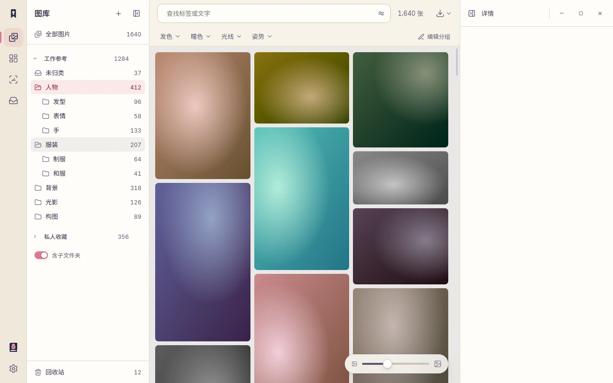 |  |
| A |  | 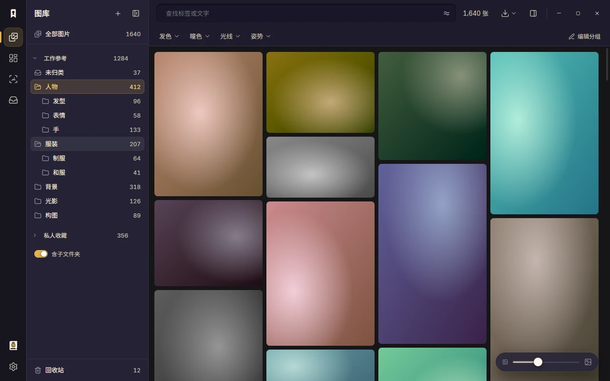 |
| B | 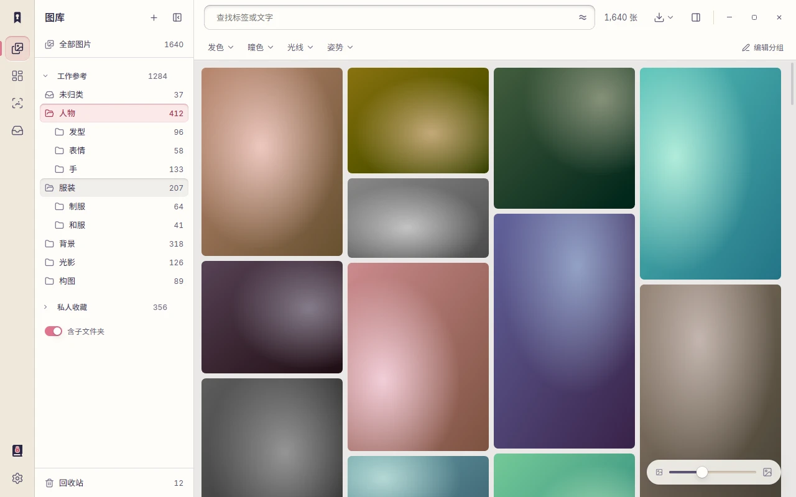 | 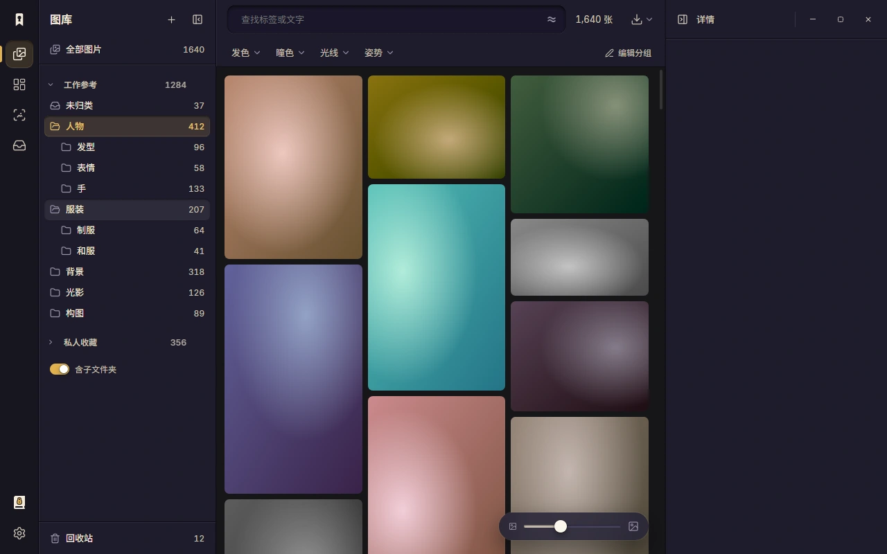 |
| C |  | 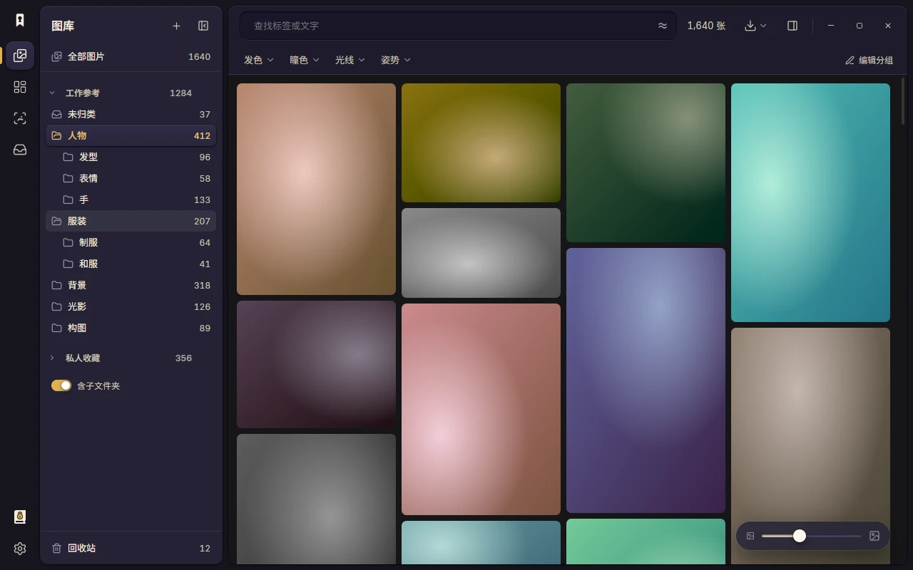 |

| | 日间 200% | 夜间 200% |
| --- | --- | --- |
| 现状 | 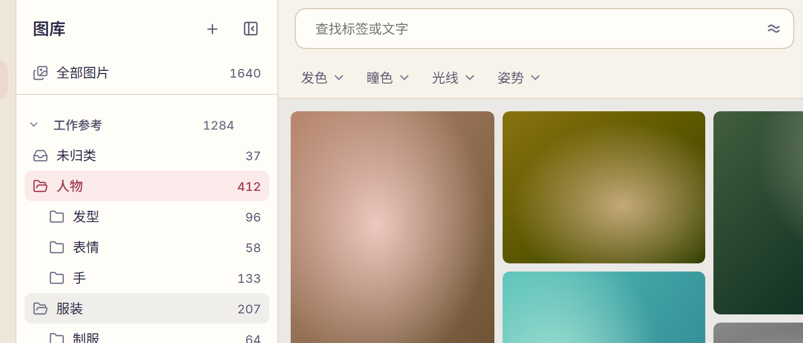 | 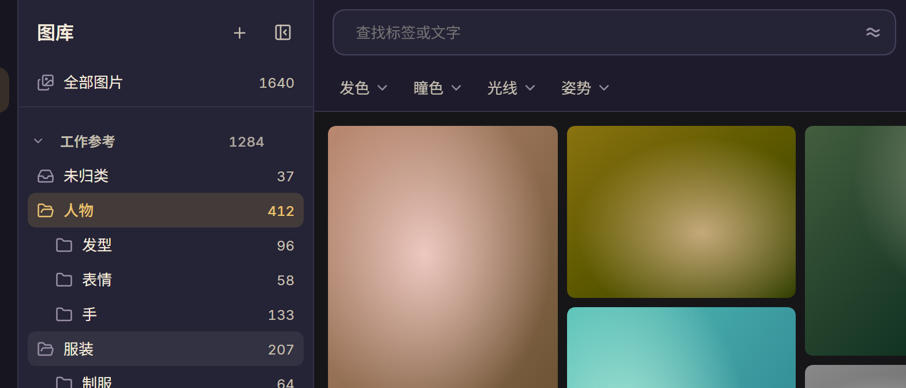 |
| A |  | 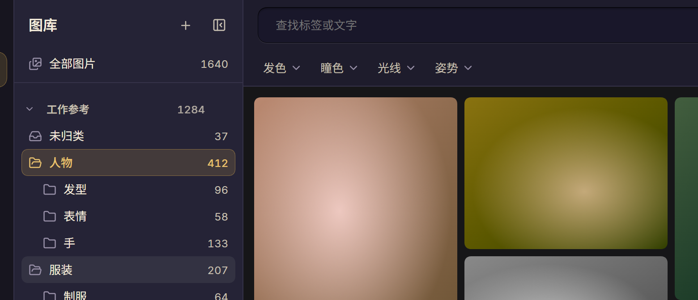 |
| B |  | 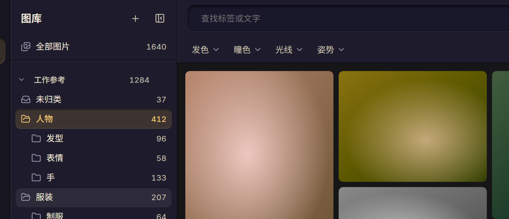 |
| C | 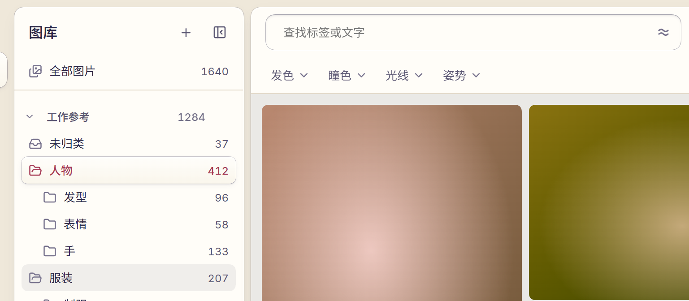 | 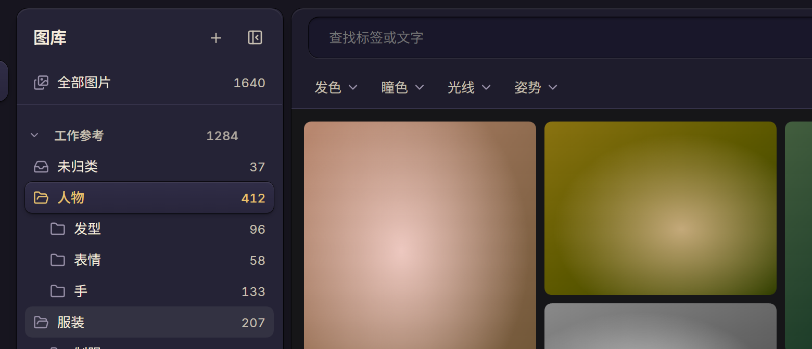 |

| | 日间材质样本 | 夜间材质样本 |
| --- | --- | --- |
| 现状 | 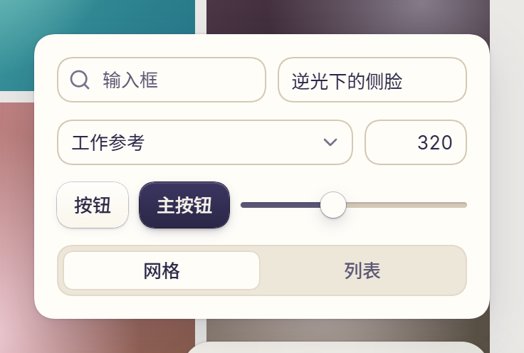 | 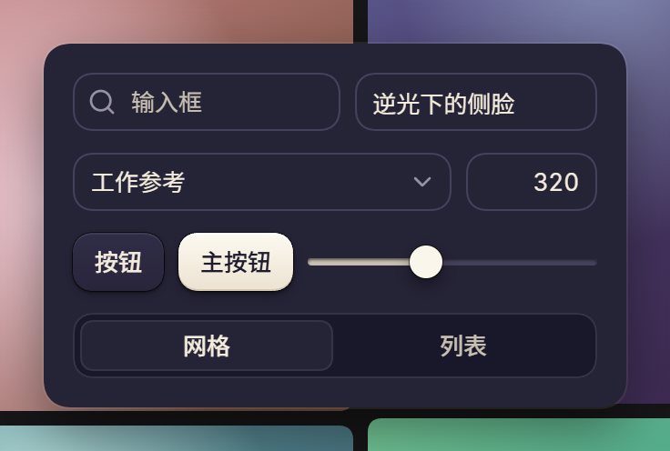 |
| A | 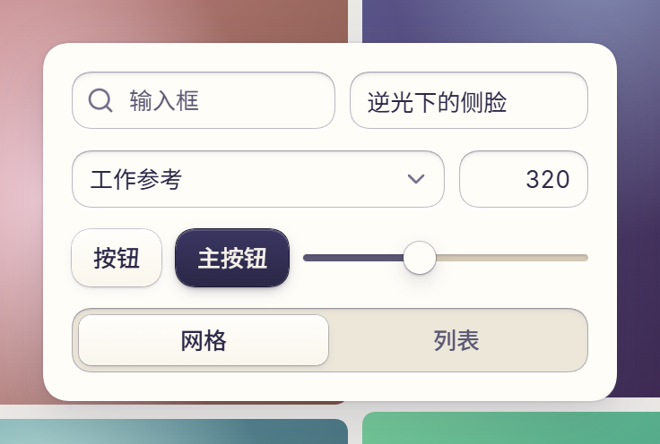 |  |
| B |  | 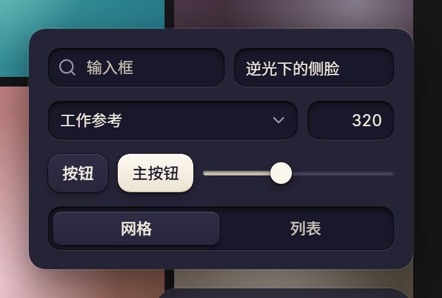 |
| C | 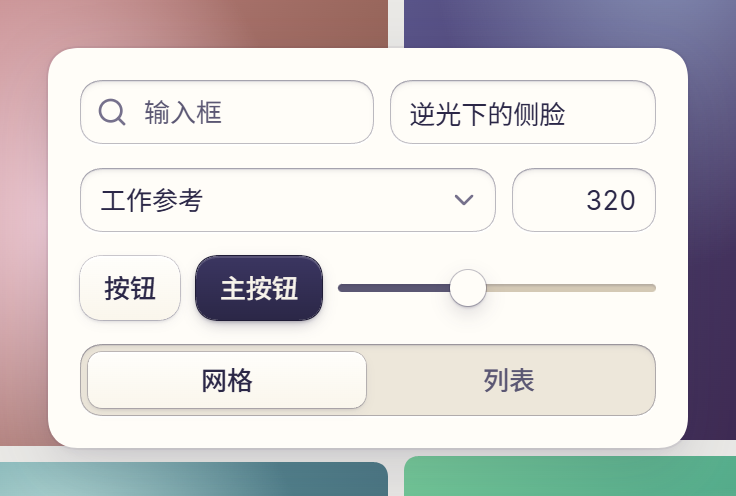 | 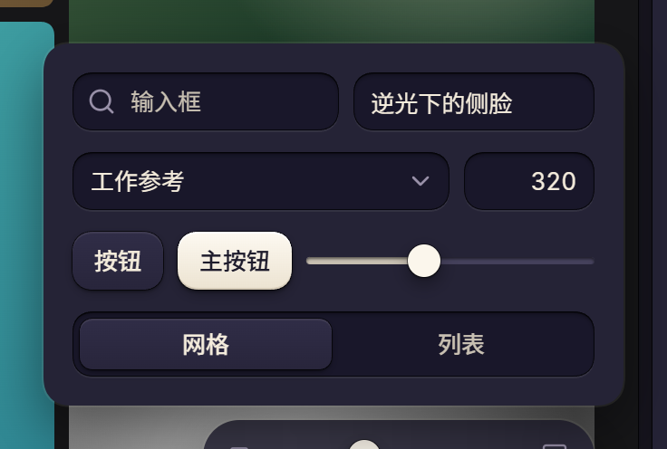 |

材质样本里的分段控件（槽加凸起的一段）只为对照同一族的东西放在一起是什么样，不在这次要定的范围里。

重新出图：开着开发服务器，运行 `node design/prototype/main-window-material/shots.mjs`。脚本用本机的 Edge 无界面运行，不装依赖。

## 没有覆盖的

- 只看了浏览图片这一屏。设置、对话框里的 `.k-input` 与 `.k-select` 会跟着换材质，这次只在材质样本里看过。
- 截图来自 Edge，不是装好的程序；内核相同，字体与样式表是同一份。没有在 125%、150% 缩放下看过半像素线。
- 动效没有做：选中块、悬停块滑动时的材质过渡留到选定方案之后。
