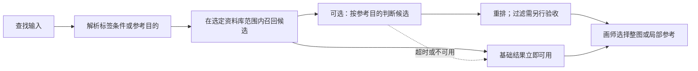

# 放进 Kinshoko 的方式

[← 返回索引](../jev-reranker-evaluation.md)

## 怎样把思路放进查找流程

下图是后续验证用的职责草案，具体检索方案尚未选定。已确认的标签入口先执行明确条件；自由描述入口要先验收自身的召回能力。

例如，标签记录 `blue_hair / short_hair / 2girls`，只有整图属性，不能支持“蓝发和短发属于同一个人”这一结论。如果查询改为“便于观察短发发束的侧面参考”，有用性还可能取决于头发是否被遮挡、目标区域是否足够清晰。已有准确备注时可做文字判断；这些视觉事实缺失时，应让实验直接使用图片，或先验证描述生成的正确性。二次元专用标签模型与按用途判断承担不同职责。[已核查标签输出边界](../tagger-integration.md)

建议先做**只改变顺序**的实验，再评估是否隐藏结果。RAG 把候选交给生成模型时，减少无关上下文有直接作用；我们的下一步是画师看图和裁切，画师可能从一张整体匹配较弱的图中取到好局部，因此过滤标准需要另做用户验证。可以保留查看全部基础结果的入口，低分也不意味着删除参考图。

试验指令可以分别询问“文字材料是否支持目标条件”“描述是否足以评价当前参考目的”，让应用处理证据不足。Jev 的受限结果不会自动提供事实解释或区域坐标；用户界面的匹配依据应来自实际标签、备注或经过验证的视觉证据，不能仅凭一个分数生成貌似可信的说明。

## 其他可比较的实现路径

除了 Jev，可以用同样的实验协议比较下列路径。这些是可获取性和接口核查，不是准确率或速度排名。

| 路径 | 一手资料支持的能力 | 对 Kinshoko 的适配判断 |
| --- | --- | --- |
| 本地标签、别名与规则排序 | 应用能够直接执行已确认条件，并利用有效标签与人工整理信息。 | 必备基线；先确认复杂模型相对它有多少实际增益。 |
| OpenAI Decisions API，`gpt-6-luna` | 2026-10-06 已发布 beta，接收文字与内联图像，返回专门的三类判断；其标准价为输入 $0.10／百万 token，输出不收费。它是云服务，不是开放权重。[指南](https://developers.openai.com/api/docs/guides/decisions)、[Decisions 定价](https://developers.openai.com/api/docs/guides/decisions#pricing-and-availability) | 对必须看图的即时小问题，优先验证直接判断候选局部；图像准备、上传、拒绝和误判均计入完整流程。详见[接口与对照评估](../multimodal-decisions-evaluation.md)。 |
| 本地文字决策模型，例：Bekko System One v0 | 同一作者于 2026-09-30 发布 17M／68M／400M 英文模型，支持 Choice／Noul／Score 和本地推理。17M 浏览器 ONNX 文件约 29 MB，但不包括运行时和工作内存；作者明确承认泛化明显弱于 Jev。[作者模型卡](https://huggingface.co/hotchpotch/bekko-system-one-v0-17m)、[发布说明](https://huggingface.co/blog/hotchpotch/bekko-system-one-v0-release) | 说明轻量、本地的结构化判断已有开放探索；英文与泛化限制使它目前适合作为研究对照，不能据演示选为中文图库默认方案。 |
| 本地多模态重排，例：Qwen3-VL-Reranker-2B | 官方提供图文配对相关性评分、可定制指令和本地加载示例；模型卡标注 Apache-2.0。官方仓库列出中文、日文支持，并说明用 yes／no token 的概率评价相关性。[模型卡](https://huggingface.co/Qwen/Qwen3-VL-Reranker-2B)、[官方架构与语言说明](https://github.com/QwenLM/Qwen3-VL-Embedding) | 更适合验证原图是否满足参考用途。2B 模型与推理资源需求需实测，不能因支持图像就承诺发型细节、人物归属和局部坐标准确。 |
| 普通模型做有限判断 | TypeSafe 官方适配器提供相似原语与可替换 endpoint，便于比较后端。[官方适配器](https://github.com/typesafe-ai/system-one-adapter-python) | 可用来测结构化判断的价值；开放模型的校准、延迟和本地资源成本需分别评估。 |

初次研究记录的 Qwen 2B 官方仓库文件总量约 4.27 GB，明显需要独立评估下载与运行资源；该数值是文件体积，不是内存或显存要求，本次没有重新核对仓库体积。未核实量化配置、Windows CPU／GPU 延迟与二次元专项成绩。[官方文件目录](https://huggingface.co/Qwen/Qwen3-VL-Reranker-2B/tree/main)

这些路径也说明：可以先复用已有的图文重排能力验证用途，再决定是否需要更小、更专门或结合人工反馈的模型。训练自有通用 System One 模型目前没有足够的领域样本和收益证据支持。

## 对当前建模的影响

以下原为 2026-10-01 的技术建模建议，领域术语沿用根目录 [GLOSSARY](../../../GLOSSARY.md)，与[数据与存储模型](../../discovery/data-storage-model.md)中区分自动／导入结果和人工决定的方向相衔接。2026-10-07 复核时，本地首版已有[规格 #42](https://github.com/Yukk1No/kinshoko/issues/42)；这里保留的是后续增强应遵守的边界，不重新决定存储或进程方案。

1. **标签事实、机器预测与本次查找评分分开表达。**已确认人工决定优先。用于评分的标签应经过当前有效规则处理，不能把被人工否决的标签重新作为肯定证据。标签预测分数、Jev Noul、Jev Score、向量相似度和其他重排分数各有含义，不应合并成一个通用“置信度”。
2. **保留明确条件与可选偏好的区别。**明确标签条件、库范围及查询逻辑由应用执行。模型可以建议解释或排序，但不能为了高分偷偷放宽条件、搜索其他库、修改标签或建立别名。基础查询已确认多条件默认同时满足，任一条件与排除由用户明确表达；增强沿用该语义。
3. **查找评分属于可重建结果。**可记录查询与条件、参考图身份、输入元数据版本、评分后端与实际模型、rubric 版本、分数类型和批次设置，用于追查结果变化。更新标签或人工决定后，旧评分需要失效；自动标签结果及人工决定仍按资料库元数据保全，原图、整理状态和引用不能依赖一个搜索缓存存在。
4. **整图与局部的评分范围明确。**整图评分不会自动成为某个参考视图的评分。若后续用裁切参与判断，要记录裁切输入与来源状态；参考组成员的裁切和布局仍各自独立。搜索排序也不能成为参考组的长期成员身份。
5. **空结果、证据不足、拒绝与服务失败有不同含义。**未召回候选、候选被低分过滤、材料不足以判断、Decisions 单问题拒绝，以及云服务超时，不能统一显示为“库里没有参考”。增强失败时仍能使用基础检索；没有可靠证据时可以保留候选供人工查看。
6. **云接入的输入范围可选择。**低 token 单价使试验可行，但文本标签与备注也属于用户资料。后端选择和所发送字段应明确；仅发送任务所需内容，本地搜索与资料库操作应保持可独立使用。数据保留和离线限制见前文事实核查。

这些职责和验证要求用于后续实验；实现遵守已确定的本地技术路线，远端增强的调度与输入准备需另定接缝，不能直接给当前纯计算 Search 模块加入网络调用。

## 建议的最小验证

这是后续实验提案，尚未执行。先取约 100–300 张有代表性的参考图、20–30 个真实中文查找任务，由画师标注候选是否可用于目的，并把“标签条件匹配”与“画师愿意拿来参考”分开记录。包括单人、多人、头发遮挡、发色／发型交叉、视角、整图／局部、中文别名、否定或偏好表达，以及库内确实无合适素材的任务。

比较路径：A 为标签与别名基线；B 为同一候选上的规则或原始检索顺序；C 为 Jev 根据有效标签、备注评分；D 为可本地运行的图文重排候选；E 为直接接收相同候选图像或局部的 OpenAI Decisions。先按[多模态小判断实验](../multimodal-decisions-evaluation.md)验证一个即时问题，再决定是否扩展到上述样本量。共同候选用于比较重排，完整搜索另测；文字与图像路径取得的证据不同，不能将全部差异归因于模型推理。自由描述需另备召回基线；“同一人物”约束的病例单列，不借一次软评分升级首版承诺。

| 要回答的问题 | 观察方法 |
| --- | --- |
| 是否更快找到可用参考 | 第一张可用参考的名次、选中它的时间，以及建立整图／局部参考的完成率。 |
| 排序是否更贴合用途 | 画师标注下的 nDCG@10、前十项可用比例；按发型、发色、多人、局部任务分别报告。 |
| 是否漏掉值得看的图 | 分别计算初筛召回率、过滤后正例保留率、空结果率；记录缺失原因。过滤比例只作规模信息。 |
| 结果是否稳定可解释 | 中文别名与点击标签得到的候选一致性；元数据缺失、候选乱序、不同拆批和版本变化下的结果。 |
| 额外成本是否可接受 | 在用户 Windows 设备上测首次可见结果、增强完成时间、P50／P95、下载与内存；云路径另计实际 token、网络和失败率。 |
| 人工纠错与失败行为是否可靠 | 被否决标签不会重新作为有效匹配依据；断网、超时、全低分和材料不足时仍有明确行为。 |

用一部分任务调指令与阈值，另一部分留作验证；不使用正例补齐来报告完整检索成绩，也不将模型自己给出的高分当作人工真值。可以先在后台记录评分并做盲序比较，实测有稳定找图收益后，再讨论用户可见重排及过滤规格。

进入正式接入讨论的依据应是：在需要及时响应的画师任务上缩短完成操作或找到参考的时间，在本次交互有效期内返回，并保持可承受的误判、纠正与运行成本。要把频繁追加大模型、人工纠正和结果跳动花掉的时间也算进去。若收益主要出现在自然语言或按用途任务，就把能力限定在那个入口；若标签基线已能快速完成任务，则继续优化识别、别名和展示即可。
