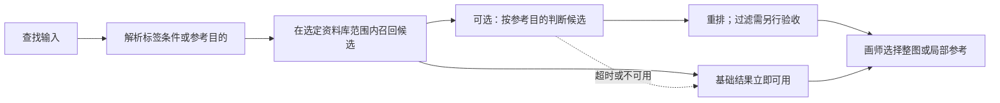

# 怎样把思路放进查找流程

下图是后续验证用的职责草案，具体检索方案尚未选定。已确认的标签入口先执行明确条件；自由描述入口要先验收自身的召回能力。

例如，标签记录 `blue_hair / short_hair / 2girls`，只有整图属性，不能支持“蓝发和短发属于同一个人”这一结论。如果查询改为“便于观察短发发束的侧面参考”，有用性还可能取决于头发是否被遮挡、目标区域是否足够清晰。已有准确备注时可做文字判断；这些视觉事实缺失时，应让实验直接使用图片，或先验证描述生成的正确性。二次元专用标签模型与按用途判断承担不同职责。[已核查标签输出边界](../tagger-integration.md)

建议先做**只改变顺序**的实验，再评估是否隐藏结果。RAG 把候选交给生成模型时，减少无关上下文有直接作用；我们的下一步是画师看图和裁切，画师可能从一张整体匹配较弱的图中取到好局部，因此过滤标准需要另做用户验证。可以保留查看全部基础结果的入口，低分也不意味着删除参考图。

试验指令可以分别询问“文字材料是否支持目标条件”“描述是否足以评价当前参考目的”，让应用处理证据不足。Jev 的受限结果不会自动提供事实解释或区域坐标；用户界面的匹配依据应来自实际标签、备注或经过验证的视觉证据，不能仅凭一个分数生成貌似可信的说明。

---

返回：[《Jev 与候选用途判断：Kinshoko 适用性评估》索引](../jev-reranker-evaluation.md)。
